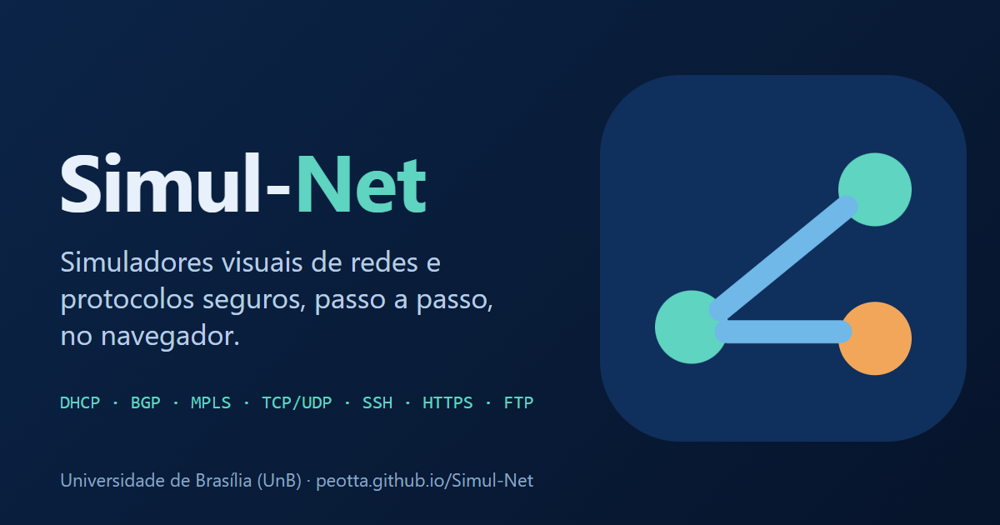

# ENE0011 - Laboratório de Redes

- **Instituição:** Universidade de Brasília (UnB)
- **Departamento:** Departamento de Engenharia Elétrica (ENE)
- **Curso:** Engenharia de Redes de Comunicação
- **Disciplina:** ENE0011 - Laboratório de Redes
- **Professor responsável:** Prof. Dr. Laerte Peotta de Melo

---

## 1. Apresentação

A disciplina **ENE0011 - Laboratório de Redes** tem como objetivo proporcionar aos alunos experiências práticas relacionadas aos conceitos fundamentais de redes de computadores, protocolos de comunicação e dispositivos de interconexão.

Ao longo do curso, os estudantes irão configurar, analisar e testar redes de computadores utilizando equipamentos reais e ambientes de simulação, consolidando os conhecimentos teóricos adquiridos em disciplinas correlatas.

Este repositório reúne os **roteiros de laboratório**, **materiais de apoio** e **instruções práticas** necessárias para a execução das atividades.

---

## 2. Objetivos da Disciplina

- Compreender o funcionamento de dispositivos de rede (hubs, switches, roteadores);
- Configurar e operar roteadores e switches, com ênfase em equipamentos Cisco;
- Analisar protocolos de comunicação nas camadas de rede e transporte;
- Interpretar informações operacionais e de diagnóstico de equipamentos de rede;
- Desenvolver raciocínio prático para identificação e resolução de problemas em redes;
- Aplicar boas práticas de segurança em dispositivos de rede (senhas seguras, SSH, hardening de camada 2).

---

## 3. Organização do Repositório

A estrutura do repositório segue o padrão abaixo:

- `laboratorios/` - Roteiros dos experimentos práticos (dispositivos de rede, segurança, VLANs, VLSM, redundância, troubleshooting e serviços de infraestrutura DHCP e DNS).
  - `topologias/` - Arquivos de simulação e topologias do Cisco Packet Tracer (`.pkt`).
- `images/` - Diagramas técnicos e ilustrações esquemáticas das práticas de laboratório.

Cada laboratório possui um roteiro próprio contendo:
- Objetivo do experimento;
- Fundamentação teórica;
- Roteiro de atividades;
- Comandos a serem utilizados;
- Orientações para entrega.

---

## 4. Laboratórios Práticos

### 4.1 Laboratórios de Redes Locais

| Laboratório | Tema | Roteiro | Packet Tracer |
|:------------:|:------|:-------:|:-------------:|
| **01** | Introdução aos Dispositivos de Redes | [Acessar](./laboratorios/01_roteiro.md) | - |
| **02** | Configurar Senhas Seguras e SSH | [Acessar](./laboratorios/02_roteiro.md) | - |
| **03** | Configurar Sub-redes com VLSM | [Acessar](./laboratorios/03_roteiro.md) | [Baixar Arquivo](./laboratorios/topologias/experimento_03_nao_configurado.pkt) |
| **04** | VLAN e Roteamento Estático | [Acessar](./laboratorios/04_roteiro.md) | [Baixar Arquivo](./laboratorios/topologias/experimento_04_nao_configurado.pkt) |
| **05** | Topologia Redundante com VLANs, EtherChannel, Roteamento Inter-VLAN, DHCP Snooping e DAI | [Acessar](./laboratorios/05_roteiro.md) | [Baixar Arquivo](./laboratorios/topologias/experimento_05_nao_configurado.pkt) |
| **06** | Desafio de Resolução de Problemas (Troubleshooting) | [Acessar](./laboratorios/06_roteiro.md) | [Baixar Arquivo](./laboratorios/topologias/experimento_06_nao_resolvido.pkt) |

### 4.2 Laboratórios de Serviços de Rede

| Laboratório | Tema | Roteiro | Ambiente / Simulador |
|:------------:|:------|:-------:|:--------------------:|
| **07** | Configuração e Análise do Protocolo DHCP | [Acessar](./laboratorios/07_roteiro.md) | PNetLab (Linux) |
| **08** | Configuração e Análise do Serviço DNS | [Acessar](./laboratorios/08_roteiro.md) | PNetLab (Linux) |

### 4.3 Laboratórios Integradores com Equipamentos Físicos

| Laboratório | Tema | Roteiro | Ambiente / Equipamentos |
|:------------:|:------|:-------:|:-----------------------:|
| **09** | Filial Isolada: VLANs, Roteamento Inter-VLAN, DHCP e Acesso Seguro | [Acessar](./laboratorios/09_roteiro.md) | Cisco 2960-24TT e 1921 |
| **10** | A Filial Cresce: Expansão, DHCP Snooping, DAI e Diagnóstico de Falhas Provocadas | [Acessar](./laboratorios/10_roteiro.md) | Cisco 2960-24TT e 1921 |
| **11** | Interligação de Filiais com Roteamento Estático | [Acessar](./laboratorios/11_roteiro.md) | Cisco 2960-24TT, 1921 e 1941 |

### 4.4 Simuladores Complementares

O hub [**Simul-Net**](https://peotta.github.io/Simul-Net/) reúne simuladores visuais que mostram, passo a passo, o funcionamento de protocolos. Os módulos de apoio aos laboratórios são:

  

| Simulador | Laboratórios de apoio |
|:----------|:---------------------:|
| [SSH](https://peotta.github.io/Simul-Net/#/sim/ssh) | 02, 09 |
| [DHCP (DORA)](https://peotta.github.io/Simul-Net/#/sim/dhcp) | 05, 07, 09, 10 |
| [ARP](https://peotta.github.io/Simul-Net/#/sim/arp) | 05, 10 |
| [ICMP (ping e traceroute)](https://peotta.github.io/Simul-Net/#/sim/icmp) | 11 |

---

## 5. Metodologia

As atividades laboratoriais serão desenvolvidas de forma **prática e supervisionada**, envolvendo:
- Configuração direta de equipamentos;
- Análise de saídas de comandos;
- Observação do comportamento da rede;
- Registro técnico dos comandos e evidências.

O aluno deve seguir rigorosamente os roteiros e registrar os resultados conforme solicitado.

---

## 6. Avaliação

A avaliação da disciplina será baseada em:
- Execução correta dos laboratórios;
- Qualidade dos relatórios técnicos e respostas às questões de análise;
- Participação e envolvimento durante as práticas;
- Cumprimento dos prazos de entrega estabelecidos.

---

## 7. Requisitos

- Conhecimentos básicos de arquitetura TCP/IP;
- Familiaridade com o ambiente de simulação Cisco Packet Tracer e PNetLab;
- Noções de comandos básicos em sistemas Linux;
- Atenção às normas de segurança e integridade do laboratório.

---

## 8. Bibliografia e Documentos Normativos

### 8.1 Bibliografia Básica

- **KUROSE, James F.; ROSS, Keith W.** Redes de computadores e a Internet: uma abordagem top-down. 8. ed. Porto Alegre: Pearson/Bookman, 2021.
- **LAMMLE, Todd.** Cisco CCNA Routing and Switching Complete Study Guide. 2. ed. Indianapolis: Sybex, 2016.
- **ODOM, Wendell.** CCNA 200-301 Official Cert Guide, Volume 1. Indianapolis: Cisco Press, 2020.

### 8.2 Bibliografia Complementar

- **COMER, Douglas E.** Interligação de redes com TCP/IP: princípios, protocolos e arquitetura. 5. ed. Rio de Janeiro: Elsevier, 2006.
- **FOROUZAN, Behrouz A.** Comunicação de dados e redes de computadores. 4. ed. São Paulo: McGraw-Hill, 2008.
- **TANENBAUM, Andrew S.; WETHERALL, David J.** Redes de computadores. 5. ed. São Paulo: Pearson, 2011.

### 8.3 Documentos Normativos e Técnicos

- **DROMS, Ralph.** Dynamic Host Configuration Protocol. RFC 2131. Bucknell University, 1997.
- **MOCKAPETRIS, Paul.** Domain names - implementation and specification. RFC 1035. ISI, 1987.
- **IEEE 802.1Q.** IEEE Standard for Local and metropolitan area networks - Bridges and Bridged Networks. IEEE, 2018.

---

## 9. Observações Importantes

- Os arquivos `.pkt` disponíveis na pasta `laboratorios/topologias/` devem ser abertos utilizando a versão recomendada do Cisco Packet Tracer.
- As evidências de execução (telas de teste de conectividade, tabelas de roteamento e saídas da CLI) devem ser anexadas aos relatórios de cada prática (individuais ou em dupla nos Experimentos 01 a 08, conforme o roteiro; um único relatório por grupo nos Experimentos 09 a 11).

---

## 10. Uso de Inteligência Artificial

Em conformidade com a Política de Integridade Acadêmica e Uso Responsável da Inteligência Artificial da Faculdade de Tecnologia (FT/UnB), aprovada pelo Conselho da FT em 30/09/2026, estabelecem-se as seguintes diretrizes:

### 10.1 Declaração Docente
Declara-se que este material didático foi elaborado com apoio de ferramentas de inteligência artificial generativa (Claude, ChatGPT e Gemini), sob estrita supervisão, revisão técnica e responsabilidade do professor responsável.

### 10.2 Diretrizes para os Estudantes
- **Regime Geral da Disciplina:** O uso de ferramentas de IA generativa é **permitido** como instrumento de apoio ao aprendizado em todas as atividades laboratoriais (pesquisa conceitual de RFCs, esclarecimento de sintaxe de comandos, interpretação de saídas e suporte à redação técnica dos relatórios).
- **Declaração de Uso de IA Generativa:** Quando houver influência relevante da IA sobre o conteúdo, a metodologia, a programação, a análise, a interpretação, os resultados ou as conclusões de uma entrega, o estudante deve incluir a Declaração de Uso de IA Generativa no relatório.
- **Atividades com Restrição ou Vedação:** Nenhuma atividade laboratorial possui restrição ou vedação específica.
- **Provas e Avaliações Individuais:** O uso de IA é **vedado**, salvo indicação expressa no enunciado.
- **Responsabilidade Acadêmica:** O estudante é o único responsável pela exatidão técnica, autoria e originalidade de suas entregas. Todas as configurações práticas, comandos executados e capturas de telas e comandos devem ser obrigatoriamente produzidos pelo estudante.
- **Condutas Vedadas:**
  - Fabricar, adulterar ou simular saídas de comandos, capturas de telas e comandos ou evidências de laboratório;
  - Apresentar análises e conclusões elaboradas com o uso de IA sem reflexão, revisão ou contribuição intelectual própria;
  - Inserir dados sensíveis, credenciais de acesso ou informações confidenciais em plataformas públicas de IA.
