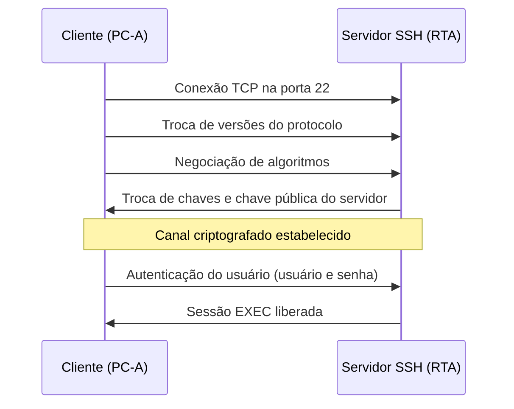

# Roteiro do Experimento 02 - Configurar Senhas Seguras e SSH

- **Instituição:** Universidade de Brasília (UnB)
- **Departamento:** Departamento de Engenharia Elétrica (ENE)
- **Curso:** Engenharia de Redes de Comunicação
- **Disciplina:** ENE0011 - Laboratório de Redes
- **Professor responsável:** Prof. Dr. Laerte Peotta de Melo
- **Tema:** Configuração básica de switches, senhas criptografadas e acesso remoto seguro via SSH

---

> **Recurso Didático:** o simulador [Simul-Net: SSH](https://peotta.github.io/Simul-Net/#/sim/ssh) apresenta, passo a passo, a negociação de algoritmos, a troca de chaves, a autenticação e os túneis do protocolo, o que complementa a comparação entre Telnet e SSH da Questão 4.

## 1. Objetivo

O objetivo deste experimento é aplicar medidas básicas de segurança em dispositivos de rede Cisco, configurando senhas seguras e habilitando o acesso remoto via SSH. Dessa forma, busca-se garantir a proteção contra acessos não autorizados e preparar o ambiente para gerenciamento confiável e seguro.

## 2. Fundamentação Teórica

Por padrão, um equipamento Cisco novo aceita acesso administrativo sem senha ou com credenciais fracas, e quem controla o equipamento controla a rede. Esta seção apresenta, em ordem: as linhas pelas quais o acesso ocorre, os mecanismos de proteção por senha, o protocolo SSH (*Secure Shell*) que substitui o Telnet, o procedimento para habilitá-lo no IOS (*Internetworking Operating System*) e as interfaces lógicas que dão ao switch um endereço de gerência.

### 2.1 Linhas de Acesso ao Cisco IOS

O acesso à CLI (*Command Line Interface*) ocorre por **linhas**. Cada tipo de linha é configurado no seu próprio modo (`Router(config-line)#`).

| Linha | Tipo | Meio de acesso | Configuração | Uso neste experimento |
| :--- | :--- | :--- | :--- | :--- |
| **Console** | Física | Cabo conectado diretamente à porta de console | `line console 0` | Acesso inicial, antes de haver rede |
| **VTY** (*Virtual Teletype*) | Virtual | Rede IP, por Telnet ou SSH | `line vty 0 4` (5 sessões simultâneas) ou `line vty 0 15` (16 sessões) | Acesso remoto por SSH |
| **Auxiliar** | Física | Porta auxiliar, geralmente com modem | `line aux 0` | Não utilizada |
| **TTY** | Física | Terminal assíncrono em conexões seriais antigas | `line tty 0` | Não utilizada |

Cada linha deve ter dois elementos de proteção: um método de autenticação (`login local`, por exemplo) e um limite de inatividade (`exec-timeout`). Linhas não utilizadas ou sem proteção são pontos de entrada para acesso não autorizado.


### 2.2 Proteção de Senhas e do Acesso Administrativo

O IOS oferece mecanismos distintos, e a diferença entre eles determina o nível de proteção real:

| Mecanismo | Comando | Proteção | Observação |
| :--- | :--- | :--- | :--- |
| Senha do modo privilegiado (fraca) | `enable password` | Texto legível na configuração, a menos que `service password-encryption` esteja ativo | Não deve ser usada; ignorada quando existe `enable secret` |
| Senha do modo privilegiado (forte) | `enable secret` | Armazenada como *hash* unidirecional (tipo 5 com `$1$`; tipos 8 e 9 em versões recentes) | Padrão recomendado |
| Criptografia de senhas em texto | `service password-encryption` | Tipo 7, reversível | Apenas **ofuscação**: impede a leitura casual, mas qualquer ferramenta de decodificação recupera a senha |
| Usuário local | `username <nome> secret <senha>` | *Hash* unidirecional | Preferir `secret` a `password` |
| Tamanho mínimo | `security passwords min-length 10` | Rejeita senhas curtas ao configurá-las | Não altera senhas já existentes |
| Bloqueio por tentativas | `login block-for 180 attempts 4 within 120` | Bloqueia novos *logins* por 180 s após 4 falhas em 120 s | Mitiga ataques de força bruta e de dicionário |
| Tempo de inatividade | `exec-timeout 6` | Encerra sessão ociosa após 6 minutos | Reduz o risco de sessões abandonadas |

**Hash e criptografia:** um *hash* não pode ser revertido; o equipamento compara o hash da senha digitada com o armazenado. A criptografia reversível (tipo 7) permite recuperar a senha original, e por isso não substitui o `secret`.

### 2.3 Ficha Técnica: SSH

| Campo | Descrição Técnica |
| :--- | :--- |
| **Nome e Sigla** | *Secure Shell* (SSH), versão 2 |
| **Camada de Referência** | Aplicação (modelos OSI e TCP/IP) |
| **Transporte e Porta** | TCP, porta 22 (o Telnet usa TCP, porta 23) |
| **Camadas internas** | Transporte (algoritmos, troca de chaves, integridade), autenticação do usuário e conexão (canais) |
| **Segurança oferecida** | Confidencialidade, integridade e autenticação do servidor e do usuário |
| **Normas** | [**RFC 4251**](https://datatracker.ietf.org/doc/html/rfc4251), [**RFC 4252**](https://datatracker.ietf.org/doc/html/rfc4252), [**RFC 4253**](https://datatracker.ietf.org/doc/html/rfc4253) e [**RFC 4254**](https://datatracker.ietf.org/doc/html/rfc4254) |

| Característica | Telnet | SSH |
| :--- | :--- | :--- |
| Criptografia da sessão | Não: usuário, senha e comandos trafegam em texto claro | Sim: toda a sessão é criptografada |
| Autenticação do servidor | Não | Sim, por chave pública do servidor |
| Integridade dos dados | Não | Sim |
| Risco de captura de credenciais | Alto, bastando um analisador de pacotes no caminho | Baixo |
| Situação recomendada | Desabilitar (`transport input ssh`) | Usar a versão 2 |

### 2.4 Estabelecimento da Sessão SSH e Requisitos no IOS

Ao se conectar, cliente e servidor percorrem as etapas abaixo antes de qualquer comando ser executado:



O servidor SSH do IOS usa uma chave RSA (*Rivest-Shamir-Adleman*) gerada no próprio equipamento. Essa chave é nomeada a partir do *hostname* e do domínio, o que explica a ordem dos passos da Seção 4:

| Requisito | Comando | Motivo |
| :--- | :--- | :--- |
| Nome do equipamento | `hostname RTA` | Compõe o nome da chave |
| Nome de domínio | `ip domain-name labredes.com` | Compõe o nome da chave; sem ele a geração é recusada |
| Chave RSA | `crypto key generate rsa` | Identifica o servidor perante o cliente. O SSH versão 2 exige chaves de pelo menos 768 bits; o roteiro usa 1024 |
| Usuário local | `username <nome> secret <senha>` | Credencial de autenticação do usuário |
| SSH versão 2 | `ip ssh version 2` | Evita a versão 1, considerada obsoleta e vulnerável |
| Linhas VTY | `transport input ssh` e `login local` | Aceita somente SSH e autentica no banco de usuários local |

### 2.5 Interface VLAN1

- A **VLAN 1** (*Virtual Local Area Network*) é a VLAN padrão dos switches Cisco; todas as portas pertencem a ela inicialmente.
- A interface VLAN1 é uma **interface lógica** que dá ao switch um endereço IP.
- Esse endereço não serve para encaminhar pacotes entre redes, e sim para a **gerência remota** do switch (Telnet, SSH e SNMP, o *Simple Network Management Protocol*).
- Um switch de camada 2 não roteia. Por isso, para responder a estações de outras sub-redes, ele precisa de um *gateway* padrão (`ip default-gateway`), usado apenas pelo tráfego do próprio switch.
- A interface só fica `up/up` se a VLAN existir e houver ao menos uma porta ativa nela.

**Aspecto de segurança:** a VLAN 1 é o padrão de fábrica e transporta o tráfego de controle (CDP e STP). Em redes de produção, recomenda-se uma VLAN de gerência dedicada, como no [Experimento 09](09_roteiro.md).

### 2.6 SVIs (Switch Virtual Interfaces)

- As SVIs (*Switch Virtual Interfaces*) são interfaces virtuais criadas em VLANs no switch; a interface VLAN1 é uma SVI.
- Cada VLAN pode ter uma SVI, permitindo que o switch seja acessado por IP dentro daquela VLAN.
- Em switches de camada 3, as SVIs também podem ser usadas para o **roteamento entre VLANs** (*inter-VLAN routing*), o que não se aplica ao 2960 usado neste experimento.

### 2.7 Normas de Referência

O acesso remoto seguro e a gerência dos equipamentos são tratados nas RFCs abaixo.

| Assunto | Norma | Aplicação neste experimento |
| :--- | :--- | :--- |
| Telnet (inseguro) | [**RFC 854**](https://datatracker.ietf.org/doc/html/rfc854) | Protocolo de terminal remoto que trafega credenciais e dados em texto claro; deve ser desabilitado |
| Arquitetura do SSH | [**RFC 4251**](https://datatracker.ietf.org/doc/html/rfc4251) | Modelo geral do *Secure Shell* (SSH), seus serviços e considerações de segurança |
| Autenticação no SSH | [**RFC 4252**](https://datatracker.ietf.org/doc/html/rfc4252) | Autenticação do usuário por senha e por chave pública (`login local` e usuário local) |
| Transporte do SSH | [**RFC 4253**](https://datatracker.ietf.org/doc/html/rfc4253) | Negociação de algoritmos, troca de chaves, criptografia e integridade da sessão (versão 2 do protocolo) |
| Canais do SSH | [**RFC 4254**](https://datatracker.ietf.org/doc/html/rfc4254) | Multiplexação de canais sobre a conexão, como a sessão de terminal nas linhas VTY |
| Gerência remota | [**RFC 3411**](https://datatracker.ietf.org/doc/html/rfc3411) | Arquitetura do *Simple Network Management Protocol* (SNMP), citado como serviço de gerência acessado pela interface VLAN1 |

## 3. Topologia e Cenário


1. Crie um cenário no Cisco Packet Tracer com os seguintes dispositivos:

   - 1 Roteador 1941

   - 1 Switch 2960

   - 1 Dispositivo final (PC/Laptop)

   - O cenário deverá ser montado e configurado da seguinte forma:

     


| **Dispositivo** | **Interface** | **Endereço IP** | **Máscara de sub-rede** | **Gateway padrão** |
| --------------- | ------------- | --------------- | ----------------------- | ------------------ |
| RTA             | G0/0          | 172.16.1.1      | 255.255.255.0           | N/D                |
| PC-A             | Placa de rede | 172.16.1.10     | 255.255.255.0           | 172.16.1.1         |
| SW1             | VLAN 1        | 172.16.1.2      | 255.255.255.0           | 172.16.1.1         |


O administrador de redes pediu que você prepare o RTA e SW1 para implantação. Antes de conectá-lo à rede, você deve ativar medidas de segurança.

## 4. Roteiro Prático Passo a Passo

### 4.1 Etapa 1: Implementar as Medidas Básicas de Segurança no Roteador

1. Configure o endereçamento IP em PC-A de acordo com a Tabela de Endereçamento.

2. Acesse o console do roteador através do terminal em PC-A.

3. Configure o nome do host como RTA.

   ```cisco
   Router>enable
   Router#conf t
   Router(config)#hostname RTA
   RTA(config)#^Z
   ```

4. Configure o endereçamento IP em RTA e ative a interface.

   ```cisco
   RTA#conf t
   RTA(config)#int G0/0
   RTA(config-if)#ip addr 172.16.1.1 255.255.255.0 
   RTA(config-if)#no shut
   RTA(config)#^Z
   ```

5. Criptografe todas as senhas em texto simples.

   ```cisco
   RTA#conf t
   RTA(config)#service password-encryption
   RTA(config)#^Z
   ```

6. Configure o comprimento mínimo para senhas para 10

   ```cisco
   RTA(config)#security passwords min-length 10
   ```

7. Configure uma senha secreta forte de sua escolha. Observação: escolha uma senha que você se
   lembre ou você precisará redefinir a atividade se estiver bloqueado no dispositivo.

   ```cisco
   RTA(config)#enable secret sua_senha
   ```

8. Desative a pesquisa de DNS (*Domain Name System*). Para evitar que o sistema tente traduzir entradas erradas.

   ```cisco
   RTA(config)#no ip domain-lookup
   ```

9. Configure o nome de domínio como labredes.com

   ```cisco
   RTA(config)#ip domain-name labredes.com
   ```

10. Crie um usuário da escolha com uma senha forte.

    ```cisco
    RTA(config)#username seu_usuario secret sua_senha
    ```

11. Gere chaves RSA de 1024 bits.

     ```cisco
    RTA(config)# crypto key generate rsa
    How many bits in the modulus [512]: 1024
     ```

     **Listar chaves RSA**

     Use o comando específico para visualizar as chaves geradas.

     ```cisco
    Router# show crypto key mypubkey rsa
     ```

     No **Cisco IOS**, você **não pode gerar uma chave RSA diferente para cada usuário**. O modelo de funcionamento é o seguinte:

     - A chave **RSA** é gerada **no dispositivo** (roteador ou switch) e associada ao **hostname** e ao **domínio** configurados.
     - Essa chave é usada pelo **servidor SSH** do equipamento para autenticar conexões seguras.
     - Todos os usuários que acessam via SSH compartilham a mesma chave pública do dispositivo.
     - O que se deve fazer é criar **usuários locais** com senhas diferentes:

     

12. Bloqueie durante três minutos qualquer pessoa que não conseguiu fazer login depois de quatro tentativas em um período de dois minutos.

     ```cisco
    RTA(config)#login block-for 180 attempts 4 within 120
     ```

13. Habilite o SSH versão 2 e configure as linhas VTY para o acesso por SSH, usando os perfis de usuário local para autenticação.

     ```cisco
    RTA(config)#ip ssh version 2
    RTA(config)#line vty 0 15
    RTA(config-line)#transport input ssh
    RTA(config-line)#login local
     ```

14. Defina o tempo limite do modo EXEC para 6 minutos nas linhas VTY.

     ```cisco
    RTA(config-line)# exec-timeout 6
     ```

15. Salve a configuração na NVRAM.

     ```cisco
    RTA#write
    ou
    RTA#copy running-config startup-config 
     ```

16. Acesse o prompt de comando na área de trabalho do PC-A para estabelecer uma conexão SSH com o RTA .

     ```cmd
    C:\ > ssh
    Packet Tracer PC SSH
    Usage: SSH -l username target
     ```

     

### 4.2 Etapa 2: Implementar as Medidas Básicas de Segurança no Switch

1. Clique em SW1 e selecione a guia CLI.

2. Configure o nome de host como SW1.

3. Configure o endereçamento IP em SW1 VLAN1 e ative a interface.

   ```cisco
   SW1(config)#interface vlan 1
   SW1(config-if)#ip address 172.16.1.2 255.255.255.0
   SW1(config-if)#no shutdown
   SW1(config-if)#exit
   SW1(config)#ip default-gateway 172.16.1.1
   ```

4. Desative todas as portas não utilizadas.

   Em um switch, é uma boa prática de segurança desabilitar portas não utilizadas.    

   Um método para fazer isso é simplesmente desligar cada porta com o comando 'shutdown'. Isso exigiria acessar cada porta individualmente.     

   Existe um método de atalho para fazer modificações em várias portas ao mesmo tempo usando o comando **interface range**. 

   No SW1, todas as portas, exceto FastEthernet0/1 e GigabitEthernet0/1, podem ser desativadas com o seguinte comando:

   ```cisco
   SW1(config)#interface range f0/2-24, g0/2
   SW1(config-if-range)#shutdown
   ```

   O comando usou o intervalo de portas de 2-24 para as portas FastEthernet e, em seguida, um único intervalo de porta de Gigabitethernet0/2.

5. Criptografe todas as senhas em texto simples.

6. Configure uma senha secreta forte de sua escolha, para o enable.

7. Desative a pesquisa de DNS.

8. Configure o nome de domínio como labredes.com

9. Crie um usuário da escolha com uma senha forte.

10. Gere chaves RSA de 1024 bits.

11. Habilite o SSH versão 2 (`ip ssh version 2`), configure as linhas VTY para o acesso por SSH (`transport input ssh`) e use os perfis de usuário local para autenticação (`login local`).

12. Defina o tempo limite do modo EXEC para 6 minutos em todas as linhas VTY.

13. Salve a configuração na NVRAM.

    


## 5. Verificação e Testes

| Comando / ação | Equipamento | O que observar |
| :--- | :---: | :--- |
| `show running-config` | RTA e SW1 | Senhas de usuário e `enable secret` criptografadas (hash `$1$`, `$5$` ou tipo 7); ausência de senhas em texto claro |
| `show ip ssh` | RTA e SW1 | `SSH Enabled - version 2.0` |
| `show crypto key mypubkey rsa` | RTA e SW1 | Chave RSA de uso geral com 1024 bits |
| `show running-config \| section line vty` | RTA e SW1 | `transport input ssh`, `login local` e `exec-timeout 6 0` |
| `show ip interface brief` | RTA e SW1 | `GigabitEthernet0/0` e `Vlan1` com os endereços da tabela e estado `up/up` |
| `ping 172.16.1.1` | PC-A | Resposta do roteador |
| `ssh -l <usuario> 172.16.1.1` e `ssh -l <usuario> 172.16.1.2` | PC-A | Solicitação de senha e acesso ao modo EXEC |

## 6. Questões para Análise

1. Mostre um print da configuração das senhas no roteador (VTY e enable secret). Explique como cada uma protege o acesso ao dispositivo.
2. Apresente um print da configuração da interface VLAN1 no switch com IP e máscara. Explique a função dessa interface.
3. Apresente um print da configuração do gateway no switch. Justifique por que o gateway seria necessário?
4. Capture a tela do PC-A estabelecendo conexão SSH com o roteador. Explique a diferença entre usar SSH e Telnet em termos de segurança.

5. Que informações trafegam em texto claro em uma sessão Telnet e quais permanecem protegidas em uma sessão SSH? Por que o SSH exige o nome de domínio e a chave RSA?
6. Qual o efeito de `login block-for 180 attempts 4 within 120` e contra qual ataque ele atua?

## 7. Critérios de Avaliação

A avaliação será realizada com base na seguinte rubrica, totalizando exatamente 10,0 pontos:

| Critério de Avaliação | Pontuação Máxima |
| :--- | :---: |
| **Roteador:** Nome, endereçamento, senhas criptografadas e `enable secret` | 2,0 |
| **Acesso SSH no roteador:** Domínio, chave RSA, usuário local, VTY e SSH versão 2 | 2,0 |
| **Switch:** Nome, SVI da VLAN 1, *gateway*, portas desativadas e SSH | 2,0 |
| **Verificação:** Evidências dos comandos da Seção 5 e conexão SSH a partir do PC-A | 1,5 |
| **Respostas às questões:** Análise fundamentada das questões da Seção 6 | 2,0 |
| **Qualidade das evidências:** Capturas de tela legíveis | 0,5 |
| **Total** | **10,0** |

## 8. Entregáveis

1. Capturas de tela dos comandos de verificação da Seção 5, de RTA e SW1.
2. Captura da sessão SSH iniciada em PC-A.
3. Arquivo `.pkt` configurado.
4. Respostas às 6 questões da Seção 6.

## 9. Conclusão

Neste experimento, o roteador e o switch receberam as medidas básicas de proteção do acesso administrativo: senhas criptografadas, autenticação local, bloqueio por tentativas falhas, tempo limite de sessão e acesso remoto exclusivamente por SSH. Essas práticas são pré-requisito para os experimentos seguintes.

---

[← Anterior: Experimento 01](01_roteiro.md) | [Índice Geral (README)](../README.md) | [Próximo: Experimento 03 →](03_roteiro.md)
