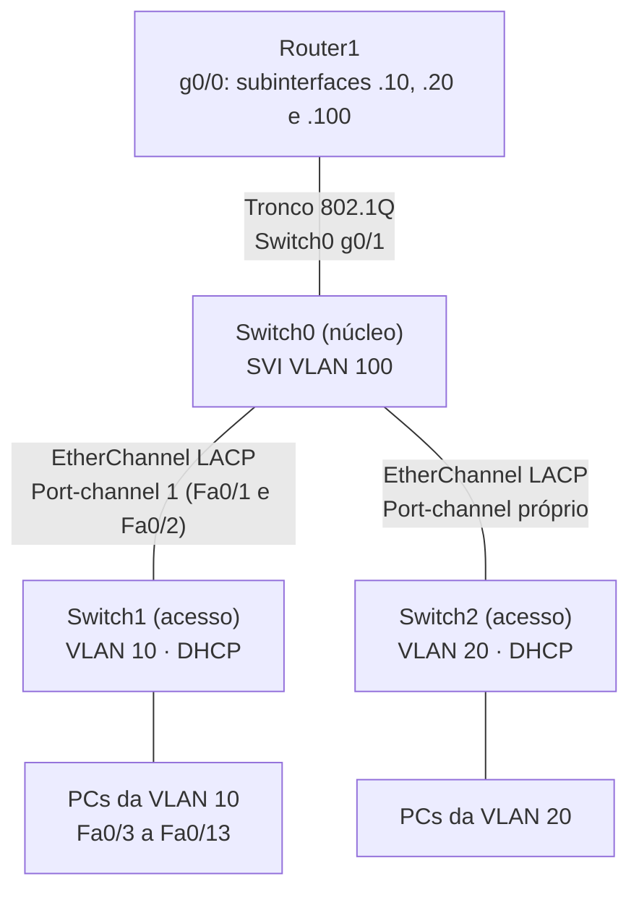

# Roteiro do Experimento 05 - Topologia Redundante com VLANs, EtherChannel, Roteamento Inter-VLAN, DHCP Snooping e DAI

- **Instituição:** Universidade de Brasília (UnB)
- **Departamento:** Departamento de Engenharia Elétrica (ENE)
- **Curso:** Engenharia de Redes de Comunicação
- **Disciplina:** ENE0011 - Laboratório de Redes
- **Professor responsável:** Prof. Dr. Laerte Peotta de Melo
- **Tema:** Agregação de enlaces com EtherChannel (LACP), roteamento inter-VLAN, DHCP em switch e proteção de camada 2 com DHCP Snooping e *Dynamic ARP Inspection* (DAI)

---

> **Recurso Didático:** os simuladores [Simul-Net: DHCP (DORA)](https://peotta.github.io/Simul-Net/#/sim/dhcp) e [Simul-Net: ARP](https://peotta.github.io/Simul-Net/#/sim/arp) mostram o processo DORA e o envenenamento de cache ARP com as respectivas defesas, base conceitual do DHCP Snooping e do DAI praticados neste roteiro.

## 1. Objetivo

Implementar uma topologia redundante em laboratório utilizando **VLANs** (*Virtual Local Area Networks*), **EtherChannel**, **roteamento inter-VLAN** e mecanismos de **segurança de camada 2**, de forma a garantir maior disponibilidade, desempenho e proteção da rede.

## 2. Fundamentação Teórica

- **Agregação de links  - EtherChannel**

  - **Agregação de Links**   É a técnica de combinar múltiplas interfaces físicas em um único enlace lógico, aumentando a largura de banda e oferecendo redundância. Na Cisco, isso é implementado por meio do **EtherChannel**, que garante maior desempenho e resiliência da rede.

  - O **EtherChannel** é uma tecnologia de agregação de links utilizada em switches Cisco que permite combinar várias interfaces físicas em um único enlace lógico.

  - Ele cria um **Port-Channel**, que é visto pelo sistema como uma única interface.

  - Isso aumenta a **largura de banda** disponível e fornece **redundância**, já que, se uma porta falhar, as demais continuam funcionando.

  - Simplifica a configuração de VLANs e trunking, pois todas as portas agregadas compartilham os mesmos parâmetros.

  - Modos de operação

    - **On**: configuração estática, sem protocolo de negociação.

    - **PAgP** (*Port Aggregation Protocol*): protocolo proprietário da Cisco para negociação automática.

    - **LACP** (*Link Aggregation Control Protocol*): protocolo padrão IEEE 802.3ad (atualmente incorporado ao IEEE 802.1AX), usado para interoperabilidade entre diferentes fabricantes.

  - Benefícios

    - Melhor utilização dos recursos físicos.
    - Simplificação da topologia: o *Spanning Tree Protocol* (STP) trata o *Port-Channel* como um único enlace e não bloqueia as portas-membro individualmente.
    - Maior resiliência e desempenho em redes corporativas.

- **DHCP Snooping**

  - É um recurso de segurança que protege contra servidores DHCP não autorizados. Ele monitora as mensagens DHCP na rede e só permite respostas vindas de portas confiáveis, evitando que dispositivos maliciosos forneçam endereços IP falsos.

  - Ele atua como um **firewall para mensagens DHCP**, permitindo apenas respostas vindas de portas confiáveis.

  - Cria uma **tabela de ligações IP-MAC-Porta** baseada nas concessões legítimas do servidor DHCP.
  - Essa tabela é usada por outros recursos de segurança, como o **Dynamic ARP Inspection (DAI)**.

  - **Portas confiáveis (trusted)**: normalmente conectadas ao servidor DHCP ou ao uplink para o core.

  - **Portas não confiáveis (untrusted)**: conectadas a dispositivos finais, onde não se espera que haja servidores DHCP.

  - Pacotes DHCP vindos de portas não confiáveis são bloqueados, evitando ataques como *DHCP spoofing*.

  - Benefícios

    - Garante que apenas servidores DHCP legítimos distribuam endereços IP.

    - Evita que atacantes forneçam configurações falsas de rede.

    - Serve de base para outras proteções, como validação de ARP.

- **Dynamic ARP Inspection (DAI)** 

  - Funciona em conjunto com o DHCP Snooping, validando pacotes ARP com base na tabela de ligações IP-MAC criada pelo DHCP. Isso impede ataques de **ARP Spoofing**, garantindo que apenas associações legítimas sejam aceitas na rede.

  - O DAI valida pacotes ARP recebidos na rede, garantindo que apenas associações legítimas entre **IP e MAC** sejam aceitas.

  - Ele utiliza a tabela de ligações criada pelo **DHCP Snooping** como referência para verificar se o dispositivo realmente possui o endereço IP que afirma ter.

  - **Portas confiáveis (trusted)**: normalmente conectadas a switches ou servidores legítimos.

  - **Portas não confiáveis (untrusted)**: conectadas a dispositivos finais, onde o risco de ataques é maior.

  - Pacotes ARP inválidos ou não correspondentes à tabela de ligações são descartados.

  - Benefícios

    - Impede ataques de **ARP spoofing**, que poderiam redirecionar tráfego para dispositivos maliciosos.

    - Garante maior integridade na comunicação entre hosts dentro da LAN.

    - Trabalha em conjunto com o DHCP Snooping para formar uma camada de defesa contra ataques de falsificação de identidade na rede.

### 2.1 Normas de Referência

Os recursos de segurança deste experimento se apoiam nas RFCs abaixo.

| Assunto | Norma | Aplicação neste experimento |
| :--- | :--- | :--- |
| DHCP | [**RFC 2131**](https://datatracker.ietf.org/doc/html/rfc2131), [**RFC 2132**](https://datatracker.ietf.org/doc/html/rfc2132) | Protocolo DHCP, processo DORA, concessão (*lease*) e opções entregues aos clientes |
| Opção 82 e retransmissão | [**RFC 3046**](https://datatracker.ietf.org/doc/html/rfc3046) | *Relay Agent Information*: opção que o switch pode inserir nas mensagens DHCP e que o servidor do roteador pode rejeitar |
| Validação da origem no DHCP | [**RFC 7513**](https://datatracker.ietf.org/doc/html/rfc7513) | *Source Address Validation Improvement* (SAVI) para DHCP: base conceitual da tabela de ligações IP-MAC-porta do DHCP Snooping |
| ARP | [**RFC 826**](https://datatracker.ietf.org/doc/html/rfc826) | Protocolo sem autenticação, o que viabiliza o *ARP spoofing* contido pelo DAI |
| Detecção de conflito de endereço | [**RFC 5227**](https://datatracker.ietf.org/doc/html/rfc5227) | *ARP Probe* e *ARP Announcement*, tipos de mensagem ARP que o DAI precisa tratar |

O EtherChannel com LACP é padronizado pelo IEEE 802.1AX (antigo 802.3ad), e o *Spanning Tree Protocol* (STP) pelo IEEE 802.1D e 802.1w. O DHCP Snooping e o DAI são recursos Cisco, sem RFC próprio.

## 3. Topologia e Cenário

### 3.1 Cenário

A rede é composta por um switch de núcleo, dois switches de acesso e um roteador que atua como *gateway* das VLANs. Cada switch de acesso atende uma VLAN de usuários e funciona também como servidor DHCP dessa VLAN.

| Dispositivo | Função | VLAN / interface lógica | Observações |
| :--- | :--- | :--- | :--- |
| **Switch0** | Núcleo (*core*) | SVI (*Switch Virtual Interface*) da VLAN 100 (gerência) | Não possui servidor DHCP nem portas de acesso. Agrega os enlaces dos switches de acesso e se liga ao roteador por tronco (`g0/1`) |
| **Switch1** | Acesso | VLAN 10 | Servidor DHCP da VLAN 10; PCs nas portas `Fa0/3` a `Fa0/13` |
| **Switch2** | Acesso | VLAN 20 | Servidor DHCP da VLAN 20 |
| **Router1** | *Gateway* das VLANs | Subinterfaces `g0/0.10`, `g0/0.20` e `g0/0.100` | Roteamento inter-VLAN por *router-on-a-stick* |
| **PCs** | Dispositivos finais | VLANs 10 e 20 | Clientes DHCP |

### 3.2 Topologia




> **Topologia Packet Tracer:** [Baixar arquivo do laboratório](./topologias/experimento_05_nao_configurado.pkt)

O diagrama acima mostra a estrutura lógica. As portas exatas de cada enlace constam no arquivo `.pkt` e devem ser conferidas antes da configuração. A redundância vem dos dois enlaces físicos de cada EtherChannel: se um falhar, o outro mantém a conectividade.

### 3.3 Plano de VLANs e Endereçamento

Escolha os blocos de rede de cada VLAN e preencha a tabela, que deve compor o **plano de endereçamento** entregue no relatório (Seção 8).

| VLAN | Uso | Rede e máscara | Gateway (subinterface do Router1) | SVI do switch |
| :---: | :--- | :--- | :--- | :--- |
| 10 | Usuários (Switch1) | | | Switch1 |
| 20 | Usuários (Switch2) | | | Switch2 |
| 100 | Gerência (núcleo) | | | Switch0 |

Requisitos para a escolha dos blocos:

- Os blocos das três VLANs não podem se sobrepor.
- O servidor DHCP de cada switch **exclui os endereços de `.1` a `.49`**, que ficam reservados à infraestrutura: o *gateway* do roteador, a SVI do switch e eventuais equipamentos com IP fixo. Os clientes recebem endereços a partir de `.50`.
- Cada bloco deve comportar os 49 endereços excluídos mais os clientes. Com 11 portas de acesso no Switch1 (`Fa0/3` a `Fa0/13`), um `/24` atende com ampla folga.
- O *gateway* (subinterface) e a SVI de cada VLAN usam endereços da própria sub-rede, dentro da faixa excluída do DHCP.
- Nos switches de acesso, a SVI está na própria VLAN de usuário, pois o servidor DHCP do switch escolhe a pool pelo endereço da interface que recebe a requisição (observação da Seção 4.1).

### 3.4 Papéis das Portas: Confiáveis e Não Confiáveis

O DHCP Snooping e o DAI só funcionam se cada porta tiver o papel correto. Defina-o antes de configurar:

| Porta ou enlace | Liga-se a | DHCP Snooping | DAI |
| :--- | :--- | :---: | :---: |
| Portas de acesso (`Fa0/3` a `Fa0/13`) | PCs (dispositivos finais) | Não confiável | Não confiável |
| EtherChannel entre acesso e núcleo (`Port-channel` e portas-membro) | Outros switches | Confiável | Confiável |
| `g0/1` do Switch0 | Router1 (tronco) | Confiável | Confiável |
| Portas não utilizadas | Nada | Desativadas (`shutdown`) | Desativadas (`shutdown`) |

Uma porta de usuário marcada como confiável permitiria que um servidor DHCP falso respondesse aos clientes; um enlace entre switches ou com o roteador marcado como não confiável faria o switch descartar respostas DHCP e requisições ARP legítimas, derrubando a comunicação.

### 3.5 Ordem de Implementação

| Etapa | Atividade | Onde | Seção |
| :---: | :--- | :--- | :---: |
| 1 | Escolher os blocos de rede (Seção 3.3) | Planejamento | 3.3 |
| 2 | Nome, acesso SSH, segurança básica e banner | Switches | 4.1 |
| 3 | Criar VLANs e configurar a SVI de gerência | Switches | 4.1 |
| 4 | Configurar as portas de acesso dos PCs | Switches de acesso | 4.1 |
| 5 | Configurar o servidor DHCP, excluindo os endereços de `.1` a `.49` | Switches de acesso | 4.1 |
| 6 | Implementar DHCP Snooping e DAI | Todos os switches | 4.1 |
| 7 | Configurar a agregação de links (EtherChannel) entre acesso e núcleo | Todos os switches | 4.1 |
| 8 | Desligar as portas não utilizadas | Todos os switches | 4.1 |
| 9 | Configurar as subinterfaces que servem de *gateway* das VLANs | Router1 | 4.2 |

A ordem importa: o DHCP Snooping e o DAI devem ser habilitados com as portas confiáveis já definidas, e o roteador só responde pelas VLANs depois que o tronco do Switch0 estiver configurado.

## 4. Roteiro Prático Passo a Passo

### 4.1 Etapa 1: Configuração do Switch1 (VLAN 10, DHCP, SSH, EtherChannels, Snooping e DAI)

1. Nome do dispositivo

   ```cisco
   enable
   configure terminal
   hostname Switch1
   ```

2. Configuração do Acesso SSH e Usuário e segurança

   ```cisco
   ip domain-name labredes.com
   service password-encryption
   enable secret sua_senha
   no ip domain-lookup
   username seu_usuario secret sua_senha
   crypto key generate rsa
   How many bits in the modulus [512]: 1024
   line vty 0 15
   transport input ssh
   login local
   exec-timeout 6
   banner motd #
   ATENÇÃO: Acesso restrito!
   Somente usuários autorizados podem entrar.
   Tentativas não autorizadas serão registradas.#
   ```

   

3. Configuração da VLAN e SVI de Gerenciamento

   ```cisco
   vlan 10
   name VLAN10
   vlan 20
   name VLAN20
   vlan 100
   name VLAN100
   ```

   ```cisco
   interface vlan 10
   ip address x.x.x.x x.x.x.x
   no shutdown
   exit
   ip default-gateway x.x.x.x
   ```

   > **Observação:** nos switches de acesso, a SVI está na própria VLAN de usuário (VLAN 10 no Switch1 e VLAN 20 no Switch2) porque o servidor DHCP do switch escolhe a pool pelo endereço da interface que recebe a requisição. A SVI faz, portanto, o papel de endereço de gerência e de interface do servidor DHCP. O Switch0 (núcleo) utiliza a SVI da VLAN 100 como gerência.

   Configuração das portas de acesso dos PCs (Fa0/3 a Fa0/13)

   ```cisco
   interface range FastEthernet0/x - x
   switchport mode access
   switchport access vlan 10
   ```

4. Configuração do Servidor DHCP (Excluindo IPs .1 a .49)

   ```cisco
   ip dhcp excluded-address x.x.x.1 x.x.x.49
   ip dhcp pool POOL_VLAN10
   network x.x.x.x x.x.x.x
   default-router x.x.x.x
   dns-server x.x.x.x
   ```

5. SEGURANÇA: DHCP Snooping e Dynamic ARP Inspection (DAI) 

   Desativa a Opção 82 (necessário no Packet Tracer para evitar rejeição de pacotes)

   ```cisco
   no ip dhcp snooping information option
   ```

   Ativa DHCP Snooping globalmente e nas VLANs

   ```cisco
   ip dhcp snooping
   ip dhcp snooping vlan 10,20,100
   ```

   Ativa Dynamic ARP Inspection (DAI) nas VLANs

   ```cisco
   ip arp inspection vlan 10,20,100
   ```

6. Configuração EtherChannel 1 (com Switch1 Fa0/1 e Fa0/2 com Switch0: Fa0/1 e Fa0/2)

   ```cisco
   interface range FastEthernet0/1 - 2
   ip dhcp snooping trust
   ip arp inspection trust
   channel-group 1 mode active
   exit
   interface Port-channel 1
   switchport mode trunk
   ip dhcp snooping trust
   ip arp inspection trust
   exit
   ```

   Em equipamentos reais, a confiança deve ser aplicada na interface `Port-channel`, que representa o enlace lógico. Nas portas-membro, o comando é mantido por compatibilidade com o Packet Tracer.

   O DAI utiliza a tabela do DHCP Snooping para validar pacotes ARP.

   Em portas do tipo *Trunk* ou *EtherChannel* que ligam switches e roteadores, **é obrigatório** manter o comando `ip arp inspection trust`.

   Se o EtherChannel não estiver marcado como confiável para o DAI (`ip arp inspection trust`), o switch começará a descartar as requisições ARP que vêm do roteador e dos outros switches, derrubando a comunicação e o ping entre os computadores das VLANs 10 e 20.

   

   Verificando configuração etherchannel

   ```cisco
   show etherchannel summary
   !ou
   show etherchannel port-channel
   ```

   

7. Desligando portas não utilizadas

   ```cisco
   int range fa0/14-24, g0/1-2
   shut
   ```

   

   **SALVAR AS CONFIGURAÇÕES**

   **Repita as mesmas configurações no switch2 e no switch0, adaptando os comandos para os parâmetros corretos.**

   **Obs.:**

   * **switch0 não tem DHCP Server ativo nem portas de acesso**

   * **cada etherchannel deve receber um número próprio que deve ser o mesmo nas duas pontas**

   

   Conexão com o Switch0 (Trunk na porta g0/1) <---> Roteador 

   ```cisco
   interface g0/1
    switchport mode trunk
    ip dhcp snooping trust
    ip arp inspection trust
   ```

   

### 4.2 Etapa 2: Configuração do Router1 (Roteamento Inter-VLAN / Router-on-a-Stick)

1. Nome do dispositivo

   ```cisco
   enable
   configure terminal
   hostname Router1
   ```

2. Sub-interface VLAN 10

   ```cisco
   interface g0/0.10
   encapsulation dot1Q 10
   ip address x.x.x.x x.x.x.x
   ```

3. Sub-interface VLAN 20

   ```cisco
   interface g0/0.20
   encapsulation dot1Q 20
   ip address x.x.x.x x.x.x.x
   ```

4. Sub-interface VLAN 100

   ```cisco
   interface g0/0.100
   encapsulation dot1Q 100
   ip address x.x.x.x x.x.x.x
   ```

5. Ativação da interface física

   ```cisco
   interface g0/0
   no shutdown
   ```

   

   


## 5. Verificação e Testes

| Comando / ação | Equipamento | O que observar |
| :--- | :---: | :--- |
| `show etherchannel summary` | Todos os switches | Port-channel com flag `SU` (camada 2, em uso) e portas-membro com flag `P` (no canal) |
| `show interfaces port-channel 1` | Switch1 | `BW` equivalente à soma dos enlaces-membro |
| `show interfaces trunk` | Todos os switches | `Port-channel` e `Gi0/1` em `trunking` |
| `show ip dhcp snooping` | Switches de acesso | Habilitado nas VLANs 10, 20 e 100; Port-channel e uplink como `trusted` |
| `show ip dhcp snooping binding` | Switches de acesso | Uma entrada (MAC, IP, VLAN, porta) por cliente |
| `show ip arp inspection vlan 10,20,100` | Switches | DAI habilitado e portas de uplink confiáveis |
| `show ip dhcp binding` | Switches de acesso | Concessões fora do intervalo excluído (`.1` a `.49`) |
| `ping` entre PCs de VLANs distintas | PCs | Resposta, via sub-interfaces do Router1 |
| `ssh -l <usuario> <IP>` | PC | Acesso remoto seguro ao switch |

## 6. Questões para Análise

1. **EtherChannel em funcionamento**   Configure o EtherChannel entre o Switch1 e o Switch0. Em seguida, execute o comando `show etherchannel summary`.
   - Pergunta: O Port-Channel aparece como ativo?
   - Evidência: Capture a tela mostrando o resultado do comando.
   - Verifique a Bandwidth/Largura de Banda do enlace com o comando `show interfaces port-channel 1`
     
2. **DHCP Snooping aplicado**   Após a configuração do DHCP Snooping. Conecte um servidor DHCP falso em uma porta não confiável e observe o comportamento.
   - Pergunta: O switch bloqueou as mensagens DHCP vindas da porta não confiável?
   - Evidência: Capture a tela mostrando a tabela de bindings (`show ip dhcp snooping binding`) e o teste com o servidor falso.

3. **Dynamic ARP Inspection:** Por que o DAI depende da tabela do DHCP Snooping? O que ocorre com um host de IP estático em uma VLAN inspecionada?
4. **Confiança em portas:** Por que as portas de uplink e o Port-channel devem ser marcados como confiáveis (DHCP Snooping e DAI) e as portas de usuário não?
5. **Segurança de acesso:** Que portas permanecem ativas após o passo "Desligando portas não utilizadas" e por que desativar as demais é uma prática de endurecimento?

## 7. Critérios de Avaliação

A avaliação será realizada com base na seguinte rubrica, totalizando exatamente 10,0 pontos:

| Critério de Avaliação | Pontuação Máxima |
| :--- | :---: |
| **VLANs, SVIs e portas de acesso:** Criação e associação corretas | 1,5 |
| **EtherChannel:** Port-channels ativos em todos os enlaces (`show etherchannel summary`) | 1,5 |
| **Router-on-a-stick:** Sub-interfaces e roteamento inter-VLAN funcionando | 1,5 |
| **DHCP:** Pools e exclusões corretas e concessões válidas | 1,5 |
| **DHCP Snooping e DAI:** Habilitação nas VLANs corretas, portas confiáveis e teste com servidor falso | 1,5 |
| **Hardening e SSH:** Portas não utilizadas desativadas e acesso por SSH | 1,0 |
| **Respostas às questões:** Análise fundamentada das questões da Seção 6 | 1,5 |
| **Total** | **10,0** |

## 8. Entregáveis

1. Arquivo `.pkt` configurado.
2. Plano de endereçamento utilizado (blocos de rede por VLAN).
3. Evidências dos comandos da Seção 5, com breve análise das saídas.
4. Evidência do teste do servidor DHCP falso (Questão 2).
5. Respostas às 5 questões da Seção 6.

## 9. Conclusão

Neste experimento, a topologia com núcleo e dois switches de acesso foi interligada por EtherChannel (LACP), com roteamento inter-VLAN por sub-interfaces, DHCP nos switches de acesso e proteção contra servidores DHCP não autorizados e *ARP spoofing* por DHCP Snooping e DAI. A prática evidencia que a segurança de camada 2 depende da correta definição de portas confiáveis e não confiáveis.

---

[← Anterior: Experimento 04](04_roteiro.md) | [Índice Geral (README)](../README.md) | [Próximo: Experimento 06 →](06_roteiro.md)

