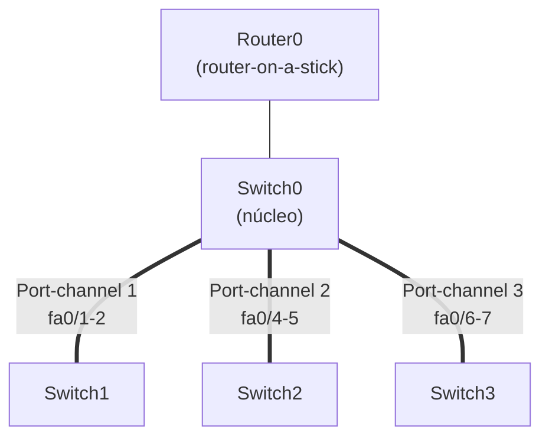
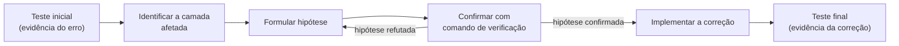

# Roteiro do Experimento 06 - Desafio de Resolução de Problemas (Troubleshooting)

- **Instituição:** Universidade de Brasília (UnB)
- **Departamento:** Departamento de Engenharia Elétrica (ENE)
- **Curso:** Engenharia de Redes de Comunicação
- **Disciplina:** ENE0011 - Laboratório de Redes
- **Professor responsável:** Prof. Dr. Laerte Peotta de Melo
- **Tema:** Metodologia sistemática de diagnóstico e resolução de problemas (troubleshooting) em redes locais

> **Pré-requisito:** Este laboratório mobiliza o acesso remoto seguro por SSH do [**Experimento 02**](02_roteiro.md), as VLANs, os troncos e o roteamento inter-VLAN do [**Experimento 04**](04_roteiro.md), e o EtherChannel e o DHCP em equipamento Cisco do [**Experimento 05**](05_roteiro.md).

---

## 1. Objetivo

O estudante deve **diagnosticar e corrigir falhas de configuração** em uma rede previamente montada no Cisco Packet Tracer.

O foco é desenvolver habilidades práticas de:

- identificação de problemas de conectividade;
- testes e validação de hipóteses;
- aplicação de soluções técnicas em VLANs (*Virtual Local Area Networks*), DHCP (*Dynamic Host Configuration Protocol*), EtherChannel e acesso remoto;
- documentação clara do processo de troubleshooting.

---

## 2. Fundamentação Teórica

### 2.1 Metodologia de Diagnóstico em Camadas

O diagnóstico deve seguir uma ordem fixa, da base para o topo, sem alterar configurações antes de identificar a camada do problema:

1. **Física e enlace:** cabos, estado das interfaces (`up/down`), portas desativadas, EtherChannel;
2. **Endereçamento e sub-redes:** IP, máscara e *gateway* dos hosts e dos equipamentos;
3. **VLANs e troncos:** associação de portas a VLANs, troncos e VLANs permitidas;
4. **Roteamento:** subinterfaces, rotas e *gateways*;
5. **Serviços:** DHCP, SSH (*Secure Shell*), DNS (*Domain Name System*).

Cada hipótese deve ser testada com um comando de verificação e registrada com a evidência antes e depois da correção.

### 2.2 Falhas Típicas por Camada

| Camada | Exemplos |
| :--- | :--- |
| Enlace | Porta `shutdown`; modos de EtherChannel incompatíveis nas pontas (`on`, `active`, `passive`, `desirable`); membros do canal com configurações diferentes |
| VLAN | Porta de acesso na VLAN errada; VLAN não criada; VLAN fora do tronco |
| Endereçamento | Máscara ou *gateway* incorretos; endereço duplicado |
| Roteamento | `encapsulation dot1Q` com VID (*VLAN Identifier*) divergente; subinterface desativada |
| Serviços | Pool DHCP com `default-router` errado; SSH sem chave RSA, sem `login local` ou com `transport input` inadequado |

### 2.3 Normas de Referência

O diagnóstico por camadas se apoia nas especificações abaixo para definir o comportamento esperado em cada teste.

| Assunto | Norma | Aplicação neste experimento |
| :--- | :--- | :--- |
| Endereçamento e encaminhamento | [**RFC 791**](https://datatracker.ietf.org/doc/html/rfc791), [**RFC 1812**](https://datatracker.ietf.org/doc/html/rfc1812) | Verificação de IP, máscara, *gateway* e rotas |
| Resolução de endereços | [**RFC 826**](https://datatracker.ietf.org/doc/html/rfc826) | Tabela ARP (*Address Resolution Protocol*) como evidência de que o enlace e a VLAN estão corretos |
| Teste de conectividade | [**RFC 792**](https://datatracker.ietf.org/doc/html/rfc792) | `ping` e mensagens de erro ICMP (*Internet Control Message Protocol*), como destino inalcançável |
| DHCP | [**RFC 2131**](https://datatracker.ietf.org/doc/html/rfc2131) | Fluxo DORA (*Discover, Offer, Request, Acknowledge*); a falha do serviço costuma deixar o *host* sem endereço válido |
| Endereço *link-local* | [**RFC 3927**](https://datatracker.ietf.org/doc/html/rfc3927) | Endereços `169.254.x.x` que o cliente adota quando não obtém concessão DHCP |
| SSH | [**RFC 4251**](https://datatracker.ietf.org/doc/html/rfc4251), [**RFC 4253**](https://datatracker.ietf.org/doc/html/rfc4253) | Requisitos do acesso remoto seguro e negociação da sessão |

---

## 3. Topologia e Cenário

O arquivo `.pkt` fornecido ([Baixar arquivo do laboratório](./topologias/experimento_06_nao_resolvido.pkt)) contém uma rede dividida em três andares, com computadores, impressoras, switches e um roteador configurados. Apesar da configuração inicial, **existem falhas de acesso** que precisam ser analisadas e corrigidas.

Para auxiliar o trabalho, esta seção documenta como a rede deveria estar configurada.

### 3.1 VLANs e Sub-redes

| VLAN | Nome | Sub-rede |
| :---: | :--- | :--- |
| 10 | TI | 192.168.10.0/24 |
| 20 | GER | 192.168.20.0/24 |
| 30 | ADM | 192.168.30.0/24 |
| 40 | IMP | 192.168.40.0/24 |

### 3.2 Switches

O Switch0 é o núcleo. Os Switches 1, 2 e 3 se conectam a ele por meio dos *Port-channels* 1, 2 e 3, respectivamente (Seção 3.3).

**Gerência (VLAN 10):**

| Switch | Endereço IP | *Gateway* |
| :--- | :--- | :--- |
| Switch0 | 192.168.10.2/24 | 192.168.10.1 |
| Switch1 | 192.168.10.3/24 | não especificado |
| Switch2 | 192.168.10.4/24 | não especificado |
| Switch3 | 192.168.10.5/24 | não especificado |

**Portas de acesso por VLAN:**

| Switch | VLAN 10 | VLAN 20 | VLAN 30 | VLAN 40 |
| :--- | :--- | :--- | :--- | :--- |
| Switch0 | g0/1 | g0/2 | fa0/16 | - |
| Switch1 | fa0/3-10 | fa0/11-15 | fa0/16-20 | fa0/21-24 |
| Switch2 | fa0/1-3, fa0/6-10 | fa0/11-15 | fa0/16-20 | fa0/21-24 |
| Switch3 | - | fa0/11-15 | fa0/16-20 | fa0/21-24 |

**Troncos:**

| Switch | Enlaces de tronco |
| :--- | :--- |
| Switch0 | Port-channel 1, 2 e 3 (Seção 3.3) e o enlace para o Router0 (`fa0/0`) |
| Switch1 | Port-channel 1 (`fa0/1-2`) |
| Switch2 | Port-channel 2 (`fa0/4-5`) |
| Switch3 | Port-channel 3 (`fa0/6-7`) |

> **Nota:** a porta do Switch0 conectada ao Router0 deve ser confirmada no arquivo `.pkt` (`show interfaces trunk` no Switch0).

### 3.3 Agregação de Enlaces (EtherChannel)

| Canal | Switch0 | Extremidade remota |
| :---: | :--- | :--- |
| 1 | fa0/1-2 | Switch1 fa0/1-2 |
| 2 | fa0/4-5 | Switch2 fa0/4-5 |
| 3 | fa0/6-7 | Switch3 fa0/6-7 |

### 3.4 DHCP

| VLAN | Nome | Faixa de endereços | *Gateway* |
| :---: | :--- | :--- | :--- |
| 10 | TI | 192.168.10.10-254 | 192.168.10.1 |
| 20 | GER | 192.168.20.10-254 | 192.168.20.1 |
| 30 | ADM | 192.168.30.10-254 | 192.168.30.1 |

### 3.5 Sem DHCP

A VLAN 40 (IMP) não utiliza DHCP e tem *gateway* 192.168.40.1. As impressoras possuem endereço fixo:

| Impressora | Endereço IP |
| :--- | :--- |
| Térreo | 192.168.40.10 |
| 1º Andar | 192.168.40.11 |
| 2º Andar | 192.168.40.12 |

### 3.6 Router 0 (Router-on-a-Stick)

| Subinterface | Endereço IP |
| :--- | :--- |
| fa0/0.10 | 192.168.10.1 |
| fa0/0.20 | 192.168.20.1 |
| fa0/0.30 | 192.168.30.1 |
| fa0/0.40 | 192.168.40.1 |

### 3.7 Acesso SSH aos Switches

- Usuário: `admin`
- Senha: `labredes`

> As credenciais acima são fictícias, de uso exclusivo neste laboratório, e não devem ser reutilizadas em outros serviços.

---

## 4. Roteiro Prático Passo a Passo

### 4.1 Procedimento de Diagnóstico

O estudante deve seguir, para cada problema, o ciclo abaixo, percorrendo as camadas na ordem da Seção 2.1:

1. Realizar os testes de conectividade e registrar o estado inicial antes de qualquer alteração.
2. Identificar a camada afetada e formular uma hipótese de causa.
3. Confirmar a hipótese com um comando de verificação (Seção 5.1) antes de alterar a configuração.
4. Implementar a solução e comentar o que foi alterado.
5. Repetir o teste que evidenciou o erro e registrar o resultado.
6. Documentar cada etapa com evidências (capturas de tela e comandos utilizados).
7. Ao final, repetir os testes finais de todos os problemas (Seção 5.2), pois a correção de um problema pode afetar os demais.
8. Entregar o relatório junto com o arquivo `.pkt` corrigido.

### 4.2 Problemas Identificados

1. **Computadores da TI não navegam na rede**
   - Teste: renovar o IP e verificar se o endereço obtido pertence à VLAN 10.
2. **Impressoras inacessíveis**
   - Teste: `ping` para os endereços das impressoras.
3. **EtherChannel entre Switch0 e Switch3 não funciona**
   - Teste: `show interfaces port-channel 3` → deve mostrar `Port-channel3 is up`.
4. **Switch1 inacessível via SSH ou `ping`**
   - Teste: `ping` para o IP de gerência ou `ssh -l [usuário] [end. IP]`.

### 4.3 Modelo de Registro por Problema

O relatório deve conter, para cada problema, uma tabela com os campos exigidos na Seção 8:

| Campo | Registro |
| :--- | :--- |
| Teste inicial | Comando executado e captura da saída que evidencia o erro |
| Descrição do problema | Sintoma observado |
| Camada afetada | Conforme a Seção 2.1 |
| Possível causa | Hipótese confirmada e o comando que a confirmou |
| Solução implementada | Comandos aplicados, com comentários |
| Teste final | Comando executado e captura da saída que evidencia a correção |

---

## 5. Verificação e Testes

### 5.1 Comandos Úteis

- `show vlan brief` → verifica VLANs criadas e portas associadas.
- `show ip interface brief` → confere IPs e estado das interfaces.
- `show running-config` → revisa a configuração atual.
- `show etherchannel summary` → verifica o estado dos canais.
- `show interfaces port-channel [numero]` → verifica o estado de um canal específico.
- `show interfaces trunk` → verifica troncos e VLANs permitidas.
- `ping [IP]` → testa conectividade.
- `ssh -l admin [IP]` → testa acesso remoto.

### 5.2 Teste Final de Cada Problema

| Problema | Teste final | Resultado esperado |
| :---: | :--- | :--- |
| 1 | Renovar IP em um PC da TI | Endereço da faixa `192.168.10.10-254` e acesso à rede |
| 2 | `ping` às impressoras (`.10`, `.11`, `.12`) | Resposta de todas |
| 3 | `show etherchannel summary` e `show interfaces port-channel 3` | Canal 3 com flag `SU` e `Port-channel3 is up` |
| 4 | `ping` e `ssh -l admin 192.168.10.3` | Resposta e acesso ao Switch1 |

---

## 6. Questões para Análise

1. Para cada problema, qual a camada afetada na metodologia da Seção 2.1 e por que a ordem das camadas reduz o tempo de diagnóstico?
2. Que sintomas distinguem uma falha de VLAN de uma falha de DHCP quando um host não obtém endereço?
3. Quais condições impedem a formação de um EtherChannel e como o `show etherchannel summary` as evidencia?
4. Que riscos de segurança existem em manter credenciais padrão e acesso SSH sem restrição nos switches?

---

## 7. Critérios de Avaliação

A avaliação será realizada com base na seguinte rubrica, totalizando exatamente 10,0 pontos:

| Critério de Avaliação | Pontuação Máxima |
| :--- | :---: |
| **Problema 1 (TI sem acesso):** Teste inicial, causa, correção e teste final | 1,5 |
| **Problema 2 (impressoras):** Teste inicial, causa, correção e teste final | 1,5 |
| **Problema 3 (EtherChannel):** Teste inicial, causa, correção e teste final | 1,5 |
| **Problema 4 (SSH/gerência do Switch1):** Teste inicial, causa, correção e teste final | 1,5 |
| **Metodologia:** Aplicação da ordem em camadas e registro das hipóteses | 1,0 |
| **Arquivo `.pkt` corrigido e funcionando** | 1,5 |
| **Respostas às questões:** Análise fundamentada das questões da Seção 6 | 1,5 |
| **Total** | **10,0** |

---

## 8. Entregáveis

O estudante deve apresentar, para cada problema:

- **Teste inicial** (evidência do erro);
- **Descrição do problema**;
- **Possível causa**;
- **Solução implementada** (com comentários);
- **Teste final** (evidência da correção).

Deve enviar, junto ao relatório, o arquivo `.pkt` com o cenário corrigido e funcionando, e as respostas às 4 questões da Seção 6.

---

## 9. Conclusão

Neste experimento, o estudante aplicou a metodologia de diagnóstico em camadas para localizar e corrigir falhas em VLANs, DHCP, EtherChannel e acesso remoto, documentando evidências antes e depois de cada correção. A prática consolida a postura investigativa e a verificação sistemática exigidas em redes de produção.

---

[← Anterior: Experimento 05](05_roteiro.md) | [Índice Geral (README)](../README.md) | [Próximo: Experimento 07 →](07_roteiro.md)
