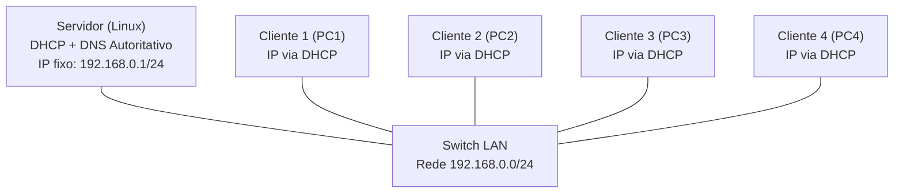
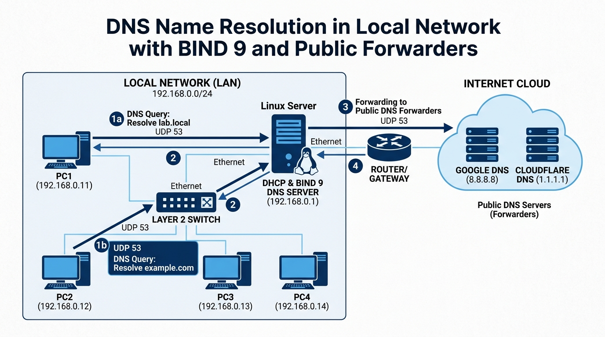

# Roteiro do Experimento 08 - Configuração e Análise do Serviço DNS

- **Instituição:** Universidade de Brasília (UnB)
- **Departamento:** Departamento de Engenharia Elétrica (ENE)
- **Curso:** Engenharia de Redes de Comunicação
- **Disciplina:** ENE0011 - Laboratório de Redes
- **Professor responsável:** Prof. Dr. Laerte Peotta de Melo
- **Tema:** Configuração e validação de serviço DNS autoritativo (BIND 9) integrado ao escopo DHCP

> **Pré-requisito:** Este laboratório dá continuidade direta à infraestrutura implementada no [**Experimento 07**](07_roteiro.md).

---

## 1. Objetivo

Este laboratório dá continuidade direta à infraestrutura implementada no [**Experimento 07**](07_roteiro.md), integrando o serviço **DNS (*Domain Name System*)** à rede local gerenciada por DHCP. O objetivo é configurar um servidor DNS autoritativo simples em ambiente Linux para resolução de nomes locais, atualizar o escopo DHCP para fornecer as configurações de DNS aos clientes e validar a resolução direta e de apelidos (*aliases*).

Ao final da atividade, o estudante deverá ser capaz de:

- compreender os conceitos fundamentais, a arquitetura e as principais normas (RFCs) que regem o protocolo DNS;
- instalar e configurar o servidor **BIND 9** para atuar como autoridade de uma zona direta simples (`lab.local`);
- criar e manipular registros de recursos básicos (**SOA**, **NS**, **A** e **CNAME**), sem a complexidade de transferência de zonas;
- configurar encaminhadores (*forwarders*) para resolver consultas de domínios externos que não pertencem à zona local;
- atualizar as opções de escopo do servidor DHCP instalado no [Experimento 07](07_roteiro.md) para distribuir o endereço do servidor DNS local aos clientes;
- validar a obtenção dinâmica das configurações de DNS nos clientes via renovação de concessão (*lease*);
- executar consultas de diagnóstico de resolução de nomes utilizando `dig`, `nslookup` e `ping`;
- inspecionar e analisar o tráfego de requisições e respostas DNS sobre a camada de transporte (UDP porta 53) com o `tcpdump`.

---

## 2. Fundamentação Teórica

O **Domain Name System (DNS)** é um sistema distribuído e hierárquico de gerenciamento de banco de dados responsável primordialmente por mapear nomes de domínio legíveis por humanos (como `servidor.lab.local`) em endereços numéricos IP (como `192.168.0.1`), permitindo a localização transparente de recursos em redes de computadores.

### 2.1 Normas e Ficha Técnica de Referência

O funcionamento, formatação de mensagens e interação do DNS com serviços de infraestrutura são padronizados pelas seguintes RFCs (*Request for Comments*) da IETF:

| Norma / RFC | Título e Escopo Técnico |
| :--- | :--- |
| [**RFC 1034**](https://datatracker.ietf.org/doc/html/rfc1034) | *Domain Names - Concepts and Facilities*: estabelece os fundamentos teóricos, o espaço de nomes de domínio em árvore e os conceitos de autoridade e zonas. |
| [**RFC 1035**](https://datatracker.ietf.org/doc/html/rfc1035) | *Domain Names - Implementation and Specification*: define a sintaxe das mensagens, o formato binário dos cabeçalhos, os tipos de registros de recursos (RR) e a operação sobre UDP e TCP. |
| [**RFC 2132**](https://datatracker.ietf.org/doc/html/rfc2132) | *DHCP Options and BOOTP Vendor Extensions*: especifica as opções 6 (*Domain Name Server Option*) e 15 (*Domain Name Option*), que permitem ao DHCP entregar automaticamente o DNS e o sufixo aos clientes. |
| [**RFC 2181**](https://datatracker.ietf.org/doc/html/rfc2181) | *Clarifications to the DNS Specification*: esclarece o tratamento de registros, semântica de autoridade e tempos de vida em cache (*Time to Live* - TTL). |
| [**RFC 1123**](https://datatracker.ietf.org/doc/html/rfc1123) | *Requirements for Internet Hosts - Application and Support*: requisitos de implementação do DNS em *hosts* e resolvedores. |
| [**RFC 1912**](https://datatracker.ietf.org/doc/html/rfc1912) | *Common DNS Operational and Configuration Errors*: erros comuns de zonas e servidores, útil para a verificação dos arquivos de zona. |
| [**RFC 2308**](https://datatracker.ietf.org/doc/html/rfc2308) | *Negative Caching of DNS Queries*: uso do último campo do SOA como TTL de respostas negativas (`NXDOMAIN`). |
| [**RFC 5936**](https://datatracker.ietf.org/doc/html/rfc5936) | *DNS Zone Transfer Protocol (AXFR)*: fundamenta a restrição `allow-transfer { none; }`. |
| [**RFC 7766**](https://datatracker.ietf.org/doc/html/rfc7766) | *DNS Transport over TCP - Implementation Requirements*: justifica o uso do TCP porta 53 para respostas extensas e transferências. |
| [**RFC 4033**](https://datatracker.ietf.org/doc/html/rfc4033) | *DNS Security Introduction and Requirements*: extensões de segurança (DNSSEC) que protegem a autenticidade das respostas, não abordadas neste experimento. |

A síntese operacional do protocolo para esta prática é consolidada na tabela a seguir:

| Campo | Descrição Técnica |
| :--- | :--- |
| **Nome e Sigla** | *Domain Name System* (DNS) |
| **Camada de Referência** | Aplicação (Modelos OSI e TCP/IP) |
| **Transporte e Portas** | **UDP porta 53** para consultas e respostas padrão da prática; **TCP porta 53** reservado para mensagens extensas |
| **Mensagens Típicas** | Consulta (*Query*) e Resposta (*Response*) com código de resposta (*RCODE*: NOERROR, NXDOMAIN, SERVFAIL) |
| **Tipo de Operação** | Resolução autoritativa para a zona local e encaminhamento (*forwarding*) para DNS externo quando o nome não for local |

### 2.2 Estrutura de Registros de Recursos (RR)

Em um arquivo de zona direta, cada linha representa um Registro de Recurso (*Resource Record* - RR). Neste laboratório introdutório, utilizam-se apenas os quatro tipos fundamentais:

1. **SOA (*Start of Authority*):** identifica o início da autoridade da zona, definindo o servidor de nomes mestre, o endereço de e-mail do administrador e os temporizadores operacionais da zona.
2. **NS (*Name Server*):** declara qual servidor hospeda autoritativamente a zona em questão.
3. **A (*Address*):** realiza o mapeamento direto entre um nome de host totalmente qualificado (*Fully Qualified Domain Name* - FQDN) e seu respectivo endereço IPv4 de 32 bits.
4. **CNAME (*Canonical Name*):** define um apelido (*alias*) para um nome canônico já existente (por exemplo, associando `web.lab.local` a `servidor.lab.local`).

### 2.3 Integração entre DHCP e Resolução de Nomes

No [Experimento 07](07_roteiro.md), o servidor DHCP distribuía aos clientes servidores DNS públicos genéricos (`8.8.8.8` e `1.1.1.1`). Como esses servidores públicos não possuem conhecimento sobre domínios locais privados, as estações de trabalho não conseguiam resolver nomes internos. 

Ao atualizar o parâmetro `domain-name-servers` do servidor DHCP para apontar para o endereço IP local `192.168.0.1`, todos os clientes da rede passam a consultar o servidor local, permitindo a comunicação entre hosts por seus nomes legíveis.

---

## 3. Topologia e Cenário

A infraestrutura aproveita integralmente a topologia construída e validada no [**Experimento 07**](07_roteiro.md), sem adição de novas máquinas virtuais ou alteração no endereçamento da rede:

- **Rede Local Única:** `192.168.0.0/24`.
- **1 Servidor Linux:** endereço IP fixo `192.168.0.1/24`, acumulando os papéis de Servidor DHCP e Servidor DNS.
- **1 Switch L2:** interconectando os nós da rede local.
- **4 Clientes Linux (PC1 a PC4):** configurados como clientes DHCP dinâmicos na faixa `192.168.0.100` a `192.168.0.150`.





*Imagem gerada com uso de inteligência artificial.*

---

## 4. Plano de Endereçamento e Resolução de Nomes

### 4.1 Endereçamento Físico e Lógico

| Dispositivo | Interface | Endereço IP | Máscara | Gateway | Papel / Função |
| :--- | :--- | :---: | :---: | :---: | :--- |
| **Servidor** | eth0 | 192.168.0.1 | 255.255.255.0 | - | Servidor DHCP e Servidor DNS local |
| **Cliente 1** | eth0 | 192.168.0.101 | 255.255.255.0 | 192.168.0.1 | Cliente DHCP / Host `pc1.lab.local` |
| **Cliente 2** | eth0 | 192.168.0.102 | 255.255.255.0 | 192.168.0.1 | Cliente DHCP / Host `pc2.lab.local` |
| **Cliente 3** | eth0 | 192.168.0.103 | 255.255.255.0 | 192.168.0.1 | Cliente DHCP / Host `pc3.lab.local` |
| **Cliente 4** | eth0 | 192.168.0.104 | 255.255.255.0 | 192.168.0.1 | Cliente DHCP / Host `pc4.lab.local` |

> *Nota:* Para que os registros `A` da zona permaneçam válidos, cada cliente recebe um endereço fixo por **reserva DHCP** associada ao endereço MAC (Seção 5.6), técnica apresentada no [Experimento 07](07_roteiro.md) (Seção 15). Sem a reserva, os endereços dinâmicos da faixa `192.168.0.100` a `192.168.0.150` poderiam diferir dos registrados.

### 4.2 Tabela de Registros DNS da Zona `lab.local`

| Nome do Host (FQDN) | Tipo | Destino / Mapeamento | Finalidade |
| :--- | :---: | :--- | :--- |
| `lab.local.` | SOA | `servidor.lab.local. admin.lab.local.` | Autoridade principal da zona |
| `lab.local.` | NS | `servidor.lab.local.` | Servidor de nomes oficial da zona |
| `servidor.lab.local.` | A | `192.168.0.1` | Endereço IP do servidor DNS/DHCP |
| `pc1.lab.local.` | A | `192.168.0.101` | Mapeamento direto do Cliente 1 |
| `pc2.lab.local.` | A | `192.168.0.102` | Mapeamento direto do Cliente 2 |
| `pc3.lab.local.` | A | `192.168.0.103` | Mapeamento direto do Cliente 3 |
| `pc4.lab.local.` | A | `192.168.0.104` | Mapeamento direto do Cliente 4 |
| `web.lab.local.` | CNAME | `servidor.lab.local.` | Apelido para serviço Web local |
| `dados.lab.local.` | CNAME | `servidor.lab.local.` | Apelido para compartilhamento de dados |

---

## 5. Roteiro Prático Passo a Passo

### 5.1 Verificação do Ponto de Partida no Servidor

Inicie a topologia no PNetLab proveniente do [Experimento 07](07_roteiro.md). No **Servidor**, confirme que o endereço IP estático e o serviço DHCP continuam ativos:

```bash
# Verificar a interface de rede eth0
ip addr show eth0

# Conferir se o serviço DHCP está operacional
sudo systemctl status isc-dhcp-server --no-pager
```

---

### 5.2 Instalação do Pacote BIND 9

No **Servidor**, instale o pacote `bind9` e os utilitários de diagnóstico DNS (`dnsutils`):

```bash
sudo apt update
sudo apt install -y bind9 bind9utils dnsutils
```

Verifique se o serviço foi iniciado:

```bash
sudo systemctl status bind9 --no-pager
```

---

### 5.3 Configuração de Opções do BIND 9 e Encaminhadores Externos

Edite o arquivo de opções globais do BIND para habilitar a escuta de consultas na rede local e configurar servidores DNS externos (*forwarders*) para resolver qualquer nome de domínio que não pertença à zona local:

```bash
sudo nano /etc/bind/named.conf.options
```

Ajuste o bloco `options` para conter a seguinte configuração:

```text
options {
    directory "/var/cache/bind";

    // Escuta na interface de loopback e na interface local eth0
    listen-on { 127.0.0.1; 192.168.0.1; };

    // Permitir consultas originadas da rede local e do próprio servidor
    allow-query { localhost; 192.168.0.0/24; };

    // Encaminhadores DNS externos (resolve nomes fora da zona local)
    forwarders {
        8.8.8.8;
        1.1.1.1;
    };

    // Habilitar recursao restrita exclusivamente a rede local
    recursion yes;
    allow-recursion { localhost; 192.168.0.0/24; };

    // Desativar suporte a IPv6 neste experimento
    listen-on-v6 { none; };
};
```

---

### 5.4 Declaração da Zona Direta Simples

Edite o arquivo `/etc/bind/named.conf.local` para declarar a zona direta `lab.local`:

```bash
sudo nano /etc/bind/named.conf.local
```

Insira a declaração da zona mestre:

```text
zone "lab.local" {
    type master;
    file "/etc/bind/db.lab.local";
    allow-transfer { none; };   // impede transferência de zona (AXFR) por terceiros
};
```

---

### 5.5 Criação do Arquivo de Zona

Crie o arquivo `/etc/bind/db.lab.local` contendo os registros de recursos mapeados na Seção 4.2:

```bash
sudo nano /etc/bind/db.lab.local
```

Insira o conteúdo abaixo:

```text
$TTL    86400
@       IN      SOA     servidor.lab.local. admin.lab.local. (
                              1         ; Serial (versao do arquivo)
                         604800         ; Refresh (7 dias)
                          86400         ; Retry (1 dia)
                        2419200         ; Expire (28 dias)
                          86400 )       ; Negative Cache TTL (1 dia)
;
; Servidor de Nomes da Zona
@       IN      NS      servidor.lab.local.

; Mapeamentos Diretos (Registros A)
servidor IN     A       192.168.0.1
pc1      IN     A       192.168.0.101
pc2      IN     A       192.168.0.102
pc3      IN     A       192.168.0.103
pc4      IN     A       192.168.0.104

; Apelidos (Registros CNAME)
web      IN     CNAME   servidor.lab.local.
dados    IN     CNAME   servidor.lab.local.
```

Valide a sintaxe dos arquivos de configuração antes de reiniciar o serviço:

```bash
# Validar arquivo principal de configuracao
sudo named-checkconf

# Validar sintaxe da zona db.lab.local
sudo named-checkzone lab.local /etc/bind/db.lab.local
```

A saída esperada do segundo comando deve ser: `OK`. Reinicie o serviço BIND 9:

```bash
sudo systemctl restart bind9
```

---

### 5.6 Reconfiguração do DHCP para Distribuir o Servidor DNS

No **Servidor**, atualize o arquivo `/etc/dhcp/dhcpd.conf` para que o escopo DHCP informe `192.168.0.1` como servidor DNS primário e `lab.local` como domínio padrão:

```bash
sudo nano /etc/dhcp/dhcpd.conf
```

Localize o bloco da sub-rede `192.168.0.0` e altere as opções `domain-name-servers` e `domain-name`:

```text
subnet 192.168.0.0 netmask 255.255.255.0 {
    range 192.168.0.100 192.168.0.150;
    option routers 192.168.0.1;
    option subnet-mask 255.255.255.0;

    # Atualizacao das opcoes de DNS (RFC 2132 - Opcoes 6 e 15)
    option domain-name "lab.local";
    option domain-name-servers 192.168.0.1;

    default-lease-time 600;
    max-lease-time 3600;

    # Reservas por MAC (substitua pelos enderecos MAC reais de cada cliente)
    host pc1 { hardware ethernet 08:00:27:aa:bb:01; fixed-address 192.168.0.101; }
    host pc2 { hardware ethernet 08:00:27:aa:bb:02; fixed-address 192.168.0.102; }
    host pc3 { hardware ethernet 08:00:27:aa:bb:03; fixed-address 192.168.0.103; }
    host pc4 { hardware ethernet 08:00:27:aa:bb:04; fixed-address 192.168.0.104; }
}
```

Em cada cliente, obtenha o MAC real com `ip link show eth0` (campo `link/ether`) e substitua os valores de exemplo acima. Os endereços MAC de exemplo não existem na topologia.

Reinicie o serviço DHCP para aplicar as alterações:

```bash
sudo systemctl restart isc-dhcp-server
sudo systemctl status isc-dhcp-server --no-pager
```

---

### 5.7 Atualização e Validação nos Clientes

Acesse o terminal de cada um dos clientes (**PC1**, **PC2**, **PC3** e **PC4**) e renove a concessão DHCP para obter os novos parâmetros de rede:

```bash
# Liberar e solicitar nova concessao DHCP
sudo dhclient -r eth0
sudo dhclient eth0
```

Verifique se o arquivo `/etc/resolv.conf` recebeu o endereço do servidor DNS local:

```bash
cat /etc/resolv.conf
```

A saída deve conter as linhas:
```text
search lab.local
nameserver 192.168.0.1
```

Em distribuições com `systemd-resolved`, o arquivo pode exibir apenas `nameserver 127.0.0.53`. Nesse caso, confirme o servidor repassado com `resolvectl status eth0`.

> **Limitação do sufixo `.local`:** o domínio `.local` é reservado ao DNS multicast ([**RFC 6762**](https://datatracker.ietf.org/doc/html/rfc6762)). Em clientes com `avahi` ou `nss-mdns`, a resolução de `pc2` ou `pc2.lab.local` por `ping` pode ser tentada via mDNS antes do DNS unicast. Se houver divergência entre `dig` e `ping`, atribua a causa a esse mecanismo e registre-a no relatório. Para redes de produção, recomenda-se um domínio sob o controle da organização ou `home.arpa` ([**RFC 8375**](https://datatracker.ietf.org/doc/html/rfc8375)).

---

## 6. Verificação e Testes

Execute os testes a partir do **PC1** e registre os resultados obtidos.

### 6.1 Resolução Direta de Nomes com `dig`

Execute a consulta para o host `servidor.lab.local`:

```bash
dig servidor.lab.local
```

Inspecione a seção `ANSWER SECTION` da saída:
```text
;; ANSWER SECTION:
servidor.lab.local.     86400   IN      A       192.168.0.1
```

Em seguida, teste a resolução dos demais clientes:

```bash
dig pc2.lab.local +short
dig pc3.lab.local +short
```

As saídas devem retornar imediatamente os respectivos endereços IPs (`192.168.0.102` e `192.168.0.103`).

### 6.2 Resolução de Apelidos (CNAME)

Consulte o nome `web.lab.local`:

```bash
dig web.lab.local
```

Observe que a resposta apresenta tanto o registro CNAME quanto o registro A canônico correspondente:
```text
;; ANSWER SECTION:
web.lab.local.          86400   IN      CNAME   servidor.lab.local.
servidor.lab.local.     86400   IN      A       192.168.0.1
```

### 6.3 Teste de Conectividade por Nome com `ping`

Valide a integração do sistema operacional executando o comando `ping` utilizando tanto o FQDN quanto apenas o nome curto do host:

```bash
# Utilizando o nome curto (o sistema aplica a diretiva search lab.local)
ping -c 3 pc2

# Utilizando o apelido CNAME
ping -c 3 web.lab.local
```

### 6.4 Resolução de Nomes Externos via Encaminhadores (*Forwarders*)

Valide a capacidade do servidor de resolver nomes externos à zona `lab.local` consultando os servidores encaminhadores configurados (`8.8.8.8` e `1.1.1.1`):

```bash
dig @192.168.0.1 unb.br +short
```

O retorno dos endereços IP públicos demonstra que as requisições para domínios que não pertencem à zona local são repassadas com sucesso aos resolvedores externos.

### 6.5 Captura e Inspeção de Tráfego com `tcpdump`

No terminal do **Servidor**, inicie a captura de pacotes filtrando pela porta UDP 53 na interface de rede:

```bash
sudo tcpdump -i eth0 -nn udp port 53 -vv
```

No **PC1**, dispare uma nova consulta:

```bash
nslookup dados.lab.local
```

No **Servidor**, interrompa o `tcpdump` com `Ctrl+C` e analise a troca de mensagens:

1. Mensagem de consulta (*Query*): enviada do IP do cliente (ex.: `192.168.0.101.XXXXX`) com destino a `192.168.0.1.53`, identificando o tipo `A?` para `dados.lab.local`.
2. Mensagem de resposta (*Response*): originada em `192.168.0.1.53` com destino ao cliente, contendo a flag de autoridade (*Authoritative Answer* - `aa`) e o código de status `NOERROR`.

---

## 7. Questões para Análise

Responda fundamentadamente às seguintes questões técnicas:

1. **[RFC 1035](https://datatracker.ietf.org/doc/html/rfc1035) e Transporte:** Por que o serviço DNS utiliza prioritariamente o protocolo UDP na porta 53 para consultas de clientes, em vez do protocolo TCP? Sob quais circunstâncias o protocolo TCP passa a ser utilizado?
2. **Integração com DHCP:** Qual a função das opções 6 (*Domain Name Server*) e 15 (*Domain Name*) da [RFC 2132](https://datatracker.ietf.org/doc/html/rfc2132) entregues pelo DHCP aos clientes? O que aconteceria se a opção 6 fosse omitida?
3. **Mecanismo de Resolução Local:** Qual a utilidade da diretiva `search lab.local` no arquivo `/etc/resolv.conf` do cliente ao executar comandos como `ping pc2`?
4. **Registros A versus CNAME:** Qual a diferença fundamental entre um registro do tipo `A` e um registro do tipo `CNAME`? Por que a literatura e as boas práticas desaconselham apontar um registro CNAME para outro registro CNAME?
5. **Campo Serial do SOA:** Qual a finalidade do campo *Serial* no registro SOA e por que ele deve ser incrementado sempre que houver modificações em uma zona DNS?
6. **Encaminhadores (*Forwarders*) e Recursão:** Como funciona a cláusula `forwarders` no BIND 9 quando o cliente requisita um domínio fora da zona local (como `unb.br`)? Por que a diretiva `allow-recursion` deve ser restrita apenas à rede local (`192.168.0.0/24`)?

---

## 8. Critérios de Avaliação

A avaliação da atividade será realizada com base na seguinte rubrica, totalizando exatamente 10,0 pontos:

| Critério de Avaliação | Pontuação Máxima |
| :--- | :---: |
| **Infraestrutura e Serviço BIND 9:** Instalação correta do BIND 9 e serviço ativo no Servidor | 1,5 |
| **Configuração da Zona Direta:** Arquivo de zona `db.lab.local` com registros SOA, NS, A e CNAME válidos | 2,0 |
| **Reconfiguração e Integração do DHCP:** Atualização do escopo DHCP distribuindo o DNS local e o sufixo | 1,5 |
| **Validação nos Clientes:** Renovação bem-sucedida do DHCP com `/etc/resolv.conf` apontando para o servidor | 1,5 |
| **Testes de Resolução:** Evidências de testes com `dig` (A, CNAME e resolução externa via forwarders) e `ping` | 1,5 |
| **Captura com `tcpdump`:** Registro e identificação das mensagens DNS *Query* e *Response* | 1,0 |
| **Respostas às Questões Técnicas:** Análise fundamentada das questões conceituais da Seção 7 | 1,0 |
| **Total** | **10,0** |

---

## 9. Entregáveis

O estudante deverá submeter relatório técnico individual ou em dupla contendo:

1. Captura de tela ou transcrição da saída do comando `sudo named-checkzone lab.local /etc/bind/db.lab.local`.
2. Conteúdo integral dos arquivos `/etc/bind/named.conf.options`, `/etc/bind/named.conf.local` e `/etc/bind/db.lab.local`.
3. Trecho do arquivo `/etc/dhcp/dhcpd.conf` demonstrando a configuração das opções de DNS entregues pelo DHCP.
4. Saída do comando `cat /etc/resolv.conf` em um dos clientes (PC1) após a renovação da concessão.
5. Capturas de tela demonstrando a resolução local (`dig servidor.lab.local`, `dig web.lab.local`) e a resolução externa via *forwarder* (`dig @192.168.0.1 unb.br +short`).
6. Registro da saída do comando `tcpdump` capturando a consulta e resposta DNS UDP/53.
7. Respostas fundamentadas às 6 questões para análise da Seção 7.

---

## 10. Conclusão

Neste experimento, os estudantes consolidaram a integração entre os serviços essenciais de infraestrutura de rede local: **DHCP** e **DNS**. A partir da topologia pré-existente do [Experimento 07](07_roteiro.md), foi demonstrado como a alocação dinâmica de endereços se articula com a resolução de nomes locais, eliminando a dependência de endereços IP numéricos fixados manualmente nas aplicações. A configuração de uma zona direta simples no BIND 9 e a análise de tráfego com o `tcpdump` reforçaram o entendimento dos papéis de registros canônicos e apelidos sobre o protocolo de transporte UDP, estabelecendo a base necessária para a futura publicação de serviços de aplicação (como servidores Web e correio eletrônico).

---

[← Anterior: Experimento 07](07_roteiro.md) | [Índice Geral (README)](../README.md) | [Próximo: Experimento 09 →](09_roteiro.md)
