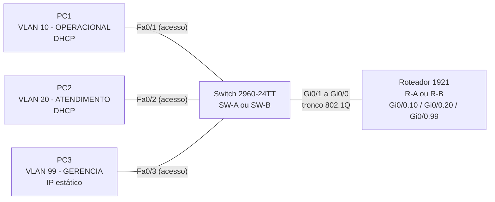

# Roteiro do Experimento 09 - Filial Isolada: VLANs, Roteamento Inter-VLAN, DHCP e Acesso Seguro em Equipamentos Físicos

- **Instituição:** Universidade de Brasília (UnB)
- **Departamento:** Departamento de Engenharia Elétrica (ENE)
- **Curso:** Engenharia de Redes de Comunicação
- **Disciplina:** ENE0011 - Laboratório de Redes
- **Professor responsável:** Prof. Dr. Laerte Peotta de Melo
- **Tema:** Projeto e implantação autônoma de uma rede de filial com switch Cisco 2960 e roteador Cisco 1921

> **Pré-requisito:** Este laboratório consolida os **Experimentos 02** (senhas e SSH), **03** (VLSM), **04** (VLANs e roteamento inter-VLAN) e **05** (DHCP em roteador Cisco). O conceito de DHCP é revisado no **Experimento 07**.

---

## 1. Objetivo

Projetar, implantar e validar, em equipamentos físicos e sem acompanhamento passo a passo, a rede de uma filial composta por um switch, um roteador e três estações. A atividade é conduzida a partir de um **cenário** e de **requisitos**: o grupo decide como cumpri-los, consultando os experimentos anteriores.

Ao final da atividade, o grupo deverá ser capaz de:

- elaborar um plano de endereçamento com VLSM (*Variable Length Subnet Masking*) a partir de requisitos de hosts por sub-rede;
- configurar VLANs, portas de acesso e um enlace tronco IEEE 802.1Q em um switch Cisco 2960;
- configurar subinterfaces em um roteador Cisco 1921 para o roteamento entre VLANs (*router-on-a-stick*);
- configurar o serviço DHCP (*Dynamic Host Configuration Protocol*) no roteador, com uma pool por VLAN;
- proteger o acesso administrativo aos equipamentos com senhas criptografadas e SSH (*Secure Shell*);
- validar o funcionamento da rede por meio de critérios de aceite objetivos, coletando evidências;
- trabalhar em equipe, com papéis definidos e documentação própria.

---

## 2. Fundamentação Teórica

Esta seção apenas organiza o que foi estudado. O aprofundamento está nos experimentos indicados na Seção 6.

### 2.1 Ficha Técnica: IEEE 802.1Q

| Campo | Descrição Técnica |
| :--- | :--- |
| **Nome e Sigla** | IEEE 802.1Q - *Virtual Bridged Local Area Networks* (VLAN) |
| **Camada de Referência** | Enlace (camada 2 do modelo OSI) |
| **Mecanismo** | Inserção de um *tag* de 4 bytes no quadro Ethernet, contendo o identificador de VLAN (VID, 12 bits, valores de 1 a 4094) |
| **Enlaces** | Acesso (quadros sem tag, uma VLAN) e tronco (quadros com tag, várias VLANs). Apenas a VLAN nativa trafega sem tag no tronco |
| **Restrição do 2960-24TT** | Suporta somente o encapsulamento 802.1Q. O comando `switchport trunk encapsulation dot1q` **não existe** nesse modelo; basta `switchport mode trunk` |
| **Norma** | IEEE 802.1Q-2018 |

### 2.2 Ficha Técnica: DHCP

| Campo | Descrição Técnica |
| :--- | :--- |
| **Nome e Sigla** | *Dynamic Host Configuration Protocol* (DHCP) |
| **Camada de Referência** | Aplicação (modelos OSI e TCP/IP) |
| **Transporte e Portas** | *User Datagram Protocol* (UDP), porta 67 (servidor) e porta 68 (cliente) |
| **Mensagens** | DISCOVER, OFFER, REQUEST e ACK (processo DORA) |
| **Normas** | [**RFC 2131**](https://datatracker.ietf.org/doc/html/rfc2131) (protocolo) e [**RFC 2132**](https://datatracker.ietf.org/doc/html/rfc2132) (opções) |

### 2.3 Roteamento Inter-VLAN com Switch de Camada 2

O 2960 é um switch de camada 2 e não encaminha pacotes entre VLANs distintas. O roteamento é feito por um roteador conectado ao switch por **um único enlace tronco**. No roteador, a interface física é dividida em **subinterfaces**, cada uma associada a uma VLAN por meio de `encapsulation dot1Q <VID>` e configurada com o endereço do *gateway* padrão daquela VLAN.

---

## 3. Cenário e Regras da Atividade

### 3.1 Cenário

Uma empresa abre uma pequena filial e contrata a equipe para implantar a rede local. A filial terá três redes lógicas: uma **operacional**, uma de **atendimento** e uma de **gerência** dos equipamentos de rede. O acesso administrativo ao switch e ao roteador deve ser feito exclusivamente por SSH, e os equipamentos devem ser endereçados em uma rede de gerência própria. As estações das duas primeiras redes devem receber o endereçamento por DHCP.

A filial deve ser implantada **sem acesso à Internet ou a outras filiais**. A interligação com a outra equipe ocorrerá somente no Experimento 11.

### 3.2 Regras

1. O professor não conduz a configuração. As dúvidas devem ser resolvidas pelos experimentos anteriores, pela Seção 8 e pelos próprios testes de aceite. O professor atua somente em **falhas de hardware** (porta, cabo ou equipamento defeituoso).
2. Nenhum comando é digitado antes de o **plano de endereçamento estar escrito e conferido** pela equipe.
3. O grupo configura apenas os equipamentos da própria bancada. É vedado copiar configurações de outro grupo.
4. Use senhas de laboratório, que **não** sejam reutilizadas em outros serviços.

---

## 4. Topologia e Cabeamento

### 4.1 Topologia Lógica

Cada grupo implanta a mesma topologia. As letras `A` e `B` diferenciam os grupos (por exemplo, `SW-A` e `R-A`).



### 4.2 Cabeamento

| Origem | Destino | Cabo | Função |
| :--- | :--- | :---: | :--- |
| PC1 (placa de rede) | SW `Fa0/1` | Direto | Acesso VLAN 10 |
| PC2 (placa de rede) | SW `Fa0/2` | Direto | Acesso VLAN 20 |
| PC3 (placa de rede) | SW `Fa0/3` | Direto | Acesso VLAN 99 |
| SW `Gi0/1` | R `Gi0/0` | Direto | Tronco 802.1Q (as portas Gigabit possuem auto-MDIX) |
| Console de SW e de R | Estações de configuração | Console (azul) | Configuração inicial |

As interfaces `Gi0/1` do switch e `Gi0/0` do roteador **não** recebem cabos de outros destinos neste experimento. A interface `Gi0/1` do roteador permanece sem uso.

### 4.3 Reset de Fábrica dos Equipamentos

Os equipamentos são reutilizados por várias turmas e chegam à bancada com configurações de uso anterior (VLANs, senhas, chaves SSH, pools DHCP). Antes de iniciar a Seção 5, cada equipe deve **restaurar o estado de fábrica** do switch e do roteador. Uma configuração residual é uma das causas mais frequentes de falhas inexplicáveis neste experimento.

Se o prompt exibir um *hostname* diferente de `Switch` ou `Router`, o equipamento está configurado e o reset é obrigatório.

#### 4.3.1 Acesso à Console

A configuração inicial e o reset são feitos pela porta de console, que independe de endereço IP. Cada equipe precisa de **dois acessos simultâneos** (um ao switch e outro ao roteador).

**Parâmetros da sessão serial:** 9600 bps, 8 bits de dados, sem paridade, 1 bit de parada e sem controle de fluxo (9600 8N1).

**Hardware:**

| Equipamento | Porta de console | Cabo e adaptador |
| :--- | :--- | :--- |
| Switch 2960-24TT | RJ45 | Cabo console azul (RJ45 para DB9). Em computadores sem porta serial, usar um adaptador USB-serial |
| Roteador 1921 | RJ45 e mini-USB (somente uma ativa por vez) | Mesmo cabo azul, ou cabo USB para mini-USB, que dispensa o adaptador. Versões antigas do Windows exigem o driver USB da Cisco |

Os adaptadores USB-serial com chip FTDI são os mais confiáveis. Os de chip Prolific ou CH340 falsificados costumam apresentar falhas de driver no Windows 10 e 11.

**Ferramentas de terminal:**

| Sistema | Ferramenta | Observações |
| :--- | :--- | :--- |
| Windows | **PuTTY** (recomendada) | Gratuita. Selecione *Connection type: Serial*, informe a porta COM e a velocidade 9600. O sinal de *Break* (Seção 4.3.6) fica em **Special Command > Break** |
| Windows | **Tera Term** | Gratuita. O *Break* fica em **Control > Send Break** |
| Windows | **MobaXterm** | Gratuita para uso básico. Reúne serial, SSH e Telnet em um só programa, o que também atende ao restante do experimento |
| Linux | **picocom** ou **minicom** | Exemplo: `picocom -b 9600 /dev/ttyUSB0`. O *Break* é `Ctrl+A` seguido de `Ctrl+\` no picocom e `Ctrl+A` seguido de `F` no minicom |
| Linux | **screen** | Exemplo: `screen /dev/ttyUSB0 9600`. O *Break* é `Ctrl+A` seguido de `b` |

**Identificação da porta serial:**

- **Windows:** abra o *Gerenciador de Dispositivos* e procure a porta em *Portas (COM e LPT)*, por exemplo `COM3`.
- **Linux:** execute `dmesg | tail` ao conectar o cabo para identificar `ttyUSB0` ou `ttyACM0`. Se o acesso for negado, adicione o usuário ao grupo `dialout` ou utilize `sudo`.

Se a tela permanecer em branco após a conexão, pressione `Enter`. Persistindo, confira a porta COM, a velocidade e o cabo.

#### 4.3.2 Switch 2960-24TT

```cisco
Switch> enable
Switch# configure terminal
Switch(config)# crypto key zeroize rsa  ! remove chaves RSA de usos anteriores (o aviso "No Signature RSA Keys found" é inofensivo)
Switch(config)# end
Switch# erase startup-config  ! apaga a configuração salva (confirme com Enter)
Switch# delete flash:vlan.dat  ! apaga o banco de VLANs, que é independente do startup-config (confirme com Enter duas vezes)
Switch# reload  ! reinicia o equipamento
```

Se aparecer a pergunta `System configuration has been modified. Save? [yes/no]:`, responda `no`. Ao final da inicialização, responda `no` à pergunta `Would you like to enter the initial configuration dialog? [yes/no]:`.

> O arquivo `vlan.dat` guarda as VLANs criadas por `vlan <id>` ou por `switchport access vlan`. Se ele não for apagado, as VLANs do grupo anterior continuam existindo mesmo após o `erase startup-config`.

#### 4.3.3 Roteador 1921

```cisco
Router> enable
Router# configure terminal
Router(config)# crypto key zeroize rsa  ! remove chaves RSA de usos anteriores
Router(config)# end
Router# erase startup-config  ! apaga a configuração salva (confirme com Enter)
Router# reload  ! reinicia o equipamento
```

Responda `no` à pergunta de salvamento, caso apareça. Ao final da inicialização, responda `no` ao diálogo de configuração inicial e, se surgir `Would you like to terminate autoinstall? [yes]`, responda `yes`.

#### 4.3.4 Verificação do Estado de Fábrica

Após a reinicialização, confirme que o equipamento está limpo antes de configurar qualquer item. Registre as saídas, pois elas compõem as evidências do relatório (Seção 12).

| Comando | Equipamento | Resultado esperado |
| :--- | :---: | :--- |
| `show startup-config` | SW e R | Mensagem `startup-config is not present` |
| `show running-config` | SW e R | *Hostname* `Switch` ou `Router`, sem usuários, sem senhas e sem pools DHCP |
| `show vlan brief` | SW | Somente a VLAN 1 (`default`) e as VLANs reservadas 1002 a 1005; todas as portas na VLAN 1 |
| `show flash:` | SW | Ausência do arquivo `vlan.dat` |
| `show crypto key mypubkey rsa` | SW e R | Nenhuma chave RSA listada |
| `show ip interface brief` | R | Nenhuma interface com endereço IP atribuído |

#### 4.3.5 Verificação da Versão do Software (IOS)

Os comandos e recursos usados nos Experimentos 09 a 11 (SSH versão 2, DHCP Snooping, *Dynamic ARP Inspection* - DAI - e espelhamento de porta com `monitor session`) dependem da imagem instalada. Antes de configurar, cada grupo deve determinar se o equipamento opera com a **versão mais recente disponível** do fabricante para o seu modelo.

**Etapa 1: identificar a versão instalada.**

```cisco
SW-A> enable
SW-A# show version                                   ! versão do IOS, modelo e nome da imagem
SW-A# show flash:                                    ! imagens (.bin) armazenadas
```

Registre o modelo (`Model number`), a versão (`Version ...`) e o arquivo de imagem (`System image file`).

**Etapa 2: descobrir a versão mais recente.** Pesquise, em fontes oficiais da Cisco (portal de suporte e documentação do produto), a última versão publicada para o modelo. Registre:

- a versão mais recente encontrada e a **data de publicação dessa versão**;
- se o modelo está em fim de venda (*end-of-sale*) ou fim de suporte (*end-of-support*), e qual é a última versão prevista no aviso de fim de vida;
- a fonte consultada (endereço da página) e a **data em que a consulta foi feita**.

**Etapa 3: comparar e concluir.**

| Equipamento | Modelo | Versão instalada | Imagem tem `k9`? | Versão mais recente encontrada | Data de publicação | Fonte | Situação |
| :--- | :--- | :--- | :--- | :--- | :--- | :--- | :--- |
| SW-A | 2960-24TT | | | | | | Atualizado / Desatualizado |
| R-A | 1921 | | | | | | Atualizado / Desatualizado |

Em `Imagem tem k9?`, a presença de `k9` no nome da imagem indica criptografia, necessária para o SSH (requisito R3). Sem ela, o comando `crypto key generate rsa` não é reconhecido e o grupo deve registrar a limitação e acionar o professor.

**Etapa 4: registrar no relatório.** Informe o resultado da tabela e responda: a versão instalada é a mais recente? Se não, que riscos (vulnerabilidades corrigidas, recursos ausentes) isso representa? Se o modelo está em fim de suporte, o que isso significa para uma rede em produção? A atualização do software **não** é realizada nesta atividade.

#### 4.3.6 Equipamento Protegido por Senha Desconhecida

Se o equipamento exigir senha de console ou de `enable` desconhecida, o reset pela CLI não é possível. Neste caso, o procedimento de recuperação exige acesso físico ao equipamento e deve ser realizado **somente com autorização do professor**, em equipamentos do laboratório. Se o equipamento estiver configurado com `no service password-recovery`, o procedimento abaixo não está disponível e a recuperação, quando permitida, apaga toda a configuração de forma irreversível; nesse caso, acione o professor.

**Switch 2960:**

1. Desligue o switch, mantenha pressionado o botão **Mode** e religue-o.
2. Solte o botão quando o LED `SYST` piscar em âmbar e depois ficar verde fixo. O prompt `switch:` será exibido. O comportamento dos LEDs pode variar conforme o modelo e a versão do software; confirme na documentação do fabricante.
3. Execute os comandos a seguir:

```cisco
switch: flash_init  ! inicializa o sistema de arquivos
switch: load_helper  ! carrega os utilitários auxiliares (quando disponível)
switch: rename flash:config.text flash:config.text.old  ! preserva o arquivo de configuração com outro nome
switch: boot  ! inicia o IOS sem a configuração anterior
```

4. Responda `no` ao diálogo de configuração inicial, entre em `enable` e apague o arquivo renomeado, o banco de VLANs e as chaves RSA anteriores:

```cisco
Switch# delete flash:config.text.old
Switch# delete flash:vlan.dat
Switch# configure terminal
Switch(config)# crypto key zeroize rsa
Switch(config)# end
Switch# reload
```

**Roteador 1921:**

1. Reinicie o roteador e envie o sinal de *Break* (`Ctrl+Break` no teclado ou **Special Command > Break** no PuTTY) durante os primeiros 60 segundos. O prompt `rommon 1 >` será exibido.
2. Execute os comandos a seguir:

```cisco
rommon 1 > confreg 0x2142  ! faz o roteador ignorar a configuração salva na próxima inicialização
rommon 2 > reset
```

3. Responda `no` ao diálogo de configuração inicial, entre em `enable` (sem senha) e restaure o registrador de configuração:

```cisco
Router# erase startup-config  ! apaga a configuração anterior
Router# configure terminal
Router(config)# config-register 0x2102  ! valor padrão: carrega a configuração salva na inicialização
Router(config)# end
Router# reload  ! responda no ao salvamento, se perguntado
```

### 4.4 Preparação das Estações de Teste

- **Desconecte** a placa de rede de qualquer outra rede (por exemplo, a rede do laboratório) e **desative o Wi-Fi** durante os testes. Do contrário, o tráfego pode sair por outra interface e invalidar os resultados.
- O *firewall* do Windows bloqueia o `ping` (*Internet Control Message Protocol* - ICMP) recebido por padrão. Libere o ICMPv4 de entrada ou desative o *firewall* na rede em uso durante a atividade.

---

## 5. Dados de Projeto

### 5.1 Blocos de Endereçamento por Grupo

| Grupo | Bloco IPv4 | Equipamentos | Domínio |
| :---: | :--- | :--- | :--- |
| **A** | `10.10.0.0/24` | `SW-A` e `R-A` | `lab.local` |
| **B** | `10.20.0.0/24` | `SW-B` e `R-B` | `lab.local` |

### 5.2 Redes Lógicas

| VLAN | Nome | Hosts a atender | Estação | Porta | Endereçamento da estação |
| :---: | :--- | :---: | :---: | :---: | :--- |
| **10** | `OPERACIONAL` | 50 | PC1 | `Fa0/1` | DHCP |
| **20** | `ATENDIMENTO` | 20 | PC2 | `Fa0/2` | DHCP |
| **99** | `GERENCIA` | 10 | PC3 | `Fa0/3` | IP estático |

Os valores da coluna "Hosts a atender" representam a **capacidade a ser projetada**, e não a quantidade de estações físicas disponíveis.

### 5.3 Convenções Obrigatórias

| Item | Convenção |
| :--- | :--- |
| Alocação das sub-redes | Em ordem decrescente de tamanho, de forma contígua, a partir do início do bloco |
| Dimensionamento | Cada sub-rede deve comportar os hosts a atender, o *gateway* e, nas VLANs com DHCP, os endereços excluídos da pool; na VLAN 99, também o IP do switch |
| Espaço de expansão | A **metade superior do bloco** (`.128/25`) deve permanecer sem uso, reservada para crescimento futuro |
| *Gateway* de cada VLAN | **Último** endereço utilizável da sub-rede |
| IP do switch | **Primeiro** endereço utilizável da VLAN 99 (interface `VLAN 99`) |
| IP de PC3 | **Segundo** endereço utilizável da VLAN 99 |
| Exclusões no DHCP | Os 5 primeiros endereços utilizáveis e o *gateway* de cada pool |
| Credenciais | Usuário local e senha definidos pela equipe, com `enable secret` diferente da senha do usuário |

---

## 6. Requisitos

O grupo deve implementar todos os requisitos abaixo. A coluna "Consultar" indica onde o assunto foi estudado; o **como** faz parte da atividade.

| ID | Requisito | Consultar |
| :---: | :--- | :--- |
| **R1** | Elaborar o plano de endereçamento VLSM: rede, máscara (decimal e CIDR), faixa utilizável, *gateway* e *broadcast* de cada VLAN, respeitando a Seção 5.3 | Exp. 03 |
| **R2** | Identificar os equipamentos: `hostname` (`SW-A`/`R-A` ou `SW-B`/`R-B`) e nome de domínio `lab.local` | Exp. 02 |
| **R3** | Proteger o acesso: `enable secret`, senhas armazenadas de forma criptografada, usuário local, *banner* de aviso e SSH versão 2 nos dois equipamentos, com Telnet desabilitado nas linhas `vty` | Exp. 02 |
| **R4** | Criar as VLANs 10, 20 e 99 com os nomes da Seção 5.2 e associar as portas `Fa0/1`, `Fa0/2` e `Fa0/3` | Exp. 04 e 05 |
| **R5** | Configurar `Gi0/1` do switch como tronco 802.1Q | Exp. 04 e 05 |
| **R6** | Configurar o endereço de gerência do switch na VLAN 99 e o *default gateway* do switch | Exp. 04 |
| **R7** | Configurar no roteador uma subinterface por VLAN em `Gi0/0`, com o *gateway* de cada rede | Exp. 04 e 05 |
| **R8** | Configurar uma pool DHCP para a VLAN 10 e outra para a VLAN 20 no roteador, com as exclusões da Seção 5.3 | Exp. 05 e 07 |
| **R9** | Configurar PC1 e PC2 para obter endereço por DHCP e PC3 com o IP estático definido na Seção 5.3 | Exp. 07 |
| **R10** | Registrar as configurações finais de ambos os equipamentos com `copy running-config startup-config` | Exp. 02 |

---

## 7. Verificação e Testes (Critérios de Aceite)

A equipe só considera o experimento concluído quando **todos** os testes abaixo forem aprovados e as evidências estiverem registradas.

### 7.1 Testes de Aceite

| ID | Teste | Onde executar | Resultado esperado |
| :---: | :--- | :--- | :--- |
| **T1** | `show vlan brief` | SW | VLANs 10, 20 e 99 ativas, com `Fa0/1`, `Fa0/2` e `Fa0/3` nas VLANs corretas |
| **T2** | `show interfaces trunk` | SW | `Gi0/1` em modo `on` e estado `trunking`, com as VLANs 10, 20 e 99 permitidas e ativas |
| **T3** | `show ip interface brief` | R | `Gi0/0` e as três subinterfaces em `up/up`, com os *gateways* do plano |
| **T4** | `ipconfig /all` (Windows) ou `ip addr` (Linux) | PC1 e PC2 | Endereço dentro da sub-rede da VLAN, fora das exclusões, com máscara e *gateway* corretos |
| **T5** | `show ip dhcp binding` e `show ip dhcp pool` | R | Duas concessões ativas (PC1 e PC2) e as duas pools com a rede e a quantidade de endereços do plano |
| **T6** | `ping` do PC1 ao *gateway* da VLAN 10 e do PC2 ao *gateway* da VLAN 20 | PC1 e PC2 | Resposta (conectividade dentro da VLAN) |
| **T7** | `ping` entre PC1, PC2 e PC3 | PC1, PC2 e PC3 | Resposta nas seis direções (roteamento inter-VLAN) |
| **T8** | `tracert` do PC1 ao PC2 | PC1 | O primeiro (e único) salto intermediário é o *gateway* da VLAN 10 |
| **T9** | `ping` ao IP de gerência do switch e ao *gateway* da VLAN 99 (roteador) | PC1 e PC3 | Resposta; a partir de PC1, comprova também o *default gateway* do switch |
| **T10** | SSH ao roteador e ao switch | PC3 (e PC1 ao switch) | Autenticação com usuário local e acesso ao modo privilegiado |
| **T11** | Teste das portas 22 e 23 | PC3 | Porta 22 aberta e porta 23 fechada |
| **T12** | `show running-config` | SW e R | Nenhuma senha em texto claro; `enable secret` presente; Telnet ausente em `transport input` |

Para o teste T11, em Windows (PowerShell):

```powershell
Test-NetConnection -ComputerName <IP_do_roteador> -Port 22   # TcpTestSucceeded deve ser True
Test-NetConnection -ComputerName <IP_do_roteador> -Port 23   # TcpTestSucceeded deve ser False
```

Em Linux, utilize `nc -vz <IP_do_roteador> 22` e `nc -vz <IP_do_roteador> 23`.

### 7.2 Como Interpretar as Saídas

| Comando | O que observar |
| :--- | :--- |
| `show vlan brief` | Colunas **VLAN** e **Name** (confirmam criação e nome) e **Ports** (portas de acesso associadas). As portas de tronco não aparecem nessa coluna |
| `show interfaces trunk` | **Mode** (`on`), **Status** (`trunking`), **Native vlan** e as listas *allowed*, *allowed and active* e *forwarding*. Uma VLAN ausente da última lista não encaminha tráfego pelo tronco |
| `show ip interface brief` | Colunas **IP-Address**, **Status** e **Protocol**. Subinterface `up/up` indica tronco funcional e `encapsulation` coerente |
| `show ip dhcp binding` | Endereço concedido, MAC do cliente e data de expiração da concessão (*lease*) |
| `show ip dhcp pool` | Rede da pool, faixa utilizável, endereços concedidos e *leased addresses* |
| `tracert` | O primeiro salto deve ser o *gateway* da própria VLAN, evidenciando que o tráfego passa pelo roteador |

---

## 8. Diagnóstico de Falhas

Utilize a metodologia em camadas: **física e enlace → endereçamento → VLANs e troncos → roteamento → serviços**. Não altere configurações antes de identificar a camada do problema.

| Sintoma | Causa provável | Como verificar e corrigir |
| :--- | :--- | :--- |
| LED da porta apagado ou interface `down` | Cabo, porta desligada ou porta errada | `show ip interface brief` (roteador) e `show interfaces status` (switch). Reconecte o cabo, use `no shutdown` e confira a Seção 4.2 |
| Estação recebe `169.254.x.x` | O DHCP não foi alcançado: porta na VLAN errada, tronco sem a VLAN, subinterface ausente ou pool incorreta | T1 e T2 no switch, T3 e T5 no roteador. Confirme o `encapsulation dot1Q` e o `network` da pool |
| Estação recebe IP de outra rede | Wi-Fi ativo ou cabo ligado à rede do laboratório | Desative as demais interfaces e repita o teste |
| `ping` ao *gateway* falha | VLAN não criada ou fora do tronco; `VID` incorreto na subinterface; máscara errada | `show vlan brief`, `show interfaces trunk` e `show running-config` na subinterface |
| `ping` ao *gateway* funciona, mas entre VLANs falha | *Firewall* do host bloqueando ICMP; *gateway* ou máscara incorretos na estação | `ipconfig /all`; libere o ICMPv4 de entrada no host |
| `ping` entre estações funciona, mas o switch não responde de outra VLAN | `ip default-gateway` ausente ou incorreto no switch | `show running-config \| include default-gateway` |
| SSH recusado | Chave RSA não gerada, `ip domain-name` ausente, usuário local inexistente, `line vty` sem `login local` ou `transport input ssh` | `show ip ssh`, `show crypto key mypubkey rsa` e `show running-config \| section line vty` |
| Cliente SSH moderno recusa a conexão (erro de algoritmo) | O IOS antigo oferece algoritmos que os clientes recentes desabilitam | Use o PuTTY ou ajuste o cliente, por exemplo `ssh -oKexAlgorithms=+diffie-hellman-group14-sha1 -oHostKeyAlgorithms=+ssh-rsa usuario@IP`. Pode ser necessário `-oCiphers=+aes128-cbc` |
| Configuração perdida após reinício | Falta de `copy running-config startup-config` | R10 |

---

## 9. Organização da Equipe

Cada grupo possui 5 estudantes. Os papéis **giram a cada experimento** (o Papel 1 do Experimento 09 passa a ser o Papel 2 no Experimento 10, e assim por diante), de modo que todos atuem em todas as funções.

| Papel | Responsabilidade |
| :---: | :--- |
| **1. Cabeamento e preparação** | Cabeamento, reset de fábrica dos equipamentos (Seção 4.3) e conferência da Seção 4 |
| **2. Switch** | Configuração do switch (R2 a R6) |
| **3. Roteador** | Configuração do roteador (R2, R3, R7 e R8) |
| **4. Estações e testes** | Configuração de PC1, PC2 e PC3, execução dos testes T1 a T12 |
| **5. Documentação** | Plano de endereçamento, registro das evidências e rascunho do relatório |

Os Papéis 2 e 3 trabalham em paralelo, cada um na console de um equipamento.

---

## 10. Questões para Análise

1. Descreva o caminho de um pacote de PC1 (VLAN 10) até PC2 (VLAN 20), indicando em quais enlaces o quadro trafega com *tag* 802.1Q e em quais trafega sem *tag*.
2. Apresente o cálculo de cada máscara do plano de endereçamento, quantos endereços utilizáveis restaram em cada sub-rede e por que a metade superior do bloco foi mantida livre.
3. O que ocorreria com as estações se `Gi0/1` do switch fosse configurada como porta de acesso na VLAN 10? Quais comandos comprovariam o problema?
4. Por que é necessário excluir endereços do intervalo distribuído pelo DHCP? Qual falha ocorreria se o *gateway* não fosse excluído?
5. Compare Telnet e SSH quanto à confidencialidade das credenciais. Que riscos permanecem mesmo com o SSH habilitado nesta rede?
6. No `tracert` de PC1 para PC2, por que o primeiro salto é o roteador, embora as duas estações estejam conectadas ao mesmo switch?

---

## 11. Critérios de Avaliação

A avaliação do relatório do grupo será realizada com base na seguinte rubrica, totalizando exatamente 10,0 pontos:

| Critério de Avaliação | Pontuação Máxima |
| :--- | :---: |
| **Plano de Endereçamento:** Tabela VLSM completa e correta, atendendo às convenções da Seção 5.3 | 1,5 |
| **Switch:** VLANs, portas de acesso, tronco e endereço de gerência corretos | 1,5 |
| **Roteador:** Subinterfaces e roteamento entre VLANs funcionando | 1,5 |
| **Acesso Seguro:** Senhas criptografadas, SSH versão 2 e Telnet desabilitado | 1,5 |
| **DHCP:** Pools, exclusões e concessões conforme o plano | 1,5 |
| **Testes de Aceite:** Testes T1 a T12 com evidências legíveis e análise das saídas | 1,5 |
| **Respostas às Questões Técnicas:** Análise fundamentada das questões da Seção 10 | 1,0 |
| **Total** | **10,0** |

---

## 12. Entregáveis

Cada grupo submete **um único relatório técnico**, contendo:

1. Identificação do grupo (A ou B), dos integrantes e dos papéis assumidos.
2. Plano de endereçamento da Seção 5, com os cálculos de VLSM.
3. Cabeamento realizado e evidências do reset de fábrica (saídas da Seção 4.3.4, obtidas antes de qualquer configuração) e tabela de versões do software da Seção 4.3.5, com a versão instalada, a versão mais recente encontrada, as datas e a fonte.
4. Saída de `show running-config` do switch e do roteador, após `copy running-config startup-config`.
5. Evidências dos testes T1 a T12, produzidas pelos próprios estudantes, acompanhadas de breve análise das saídas.
6. Descrição das falhas encontradas durante a atividade, com a camada afetada e a correção aplicada.
7. Respostas fundamentadas às 6 questões da Seção 10.

---

## 13. Conclusão

Neste experimento, a equipe percorreu o ciclo completo de implantação de uma rede de filial: projeto do endereçamento, segmentação em VLANs, roteamento entre VLANs com um switch de camada 2, distribuição automática de endereços e proteção do acesso administrativo. A atividade conduzida por requisitos e critérios de aceite exercita a autonomia técnica, e a documentação gerada servirá de base para os Experimentos 10 e 11, nos quais a filial será protegida contra falhas e interligada à outra equipe.

---

[← Anterior: Experimento 08](08_roteiro.md) | [Índice Geral (README)](../README.md) | [Próximo: Experimento 10 →](10_roteiro.md)
