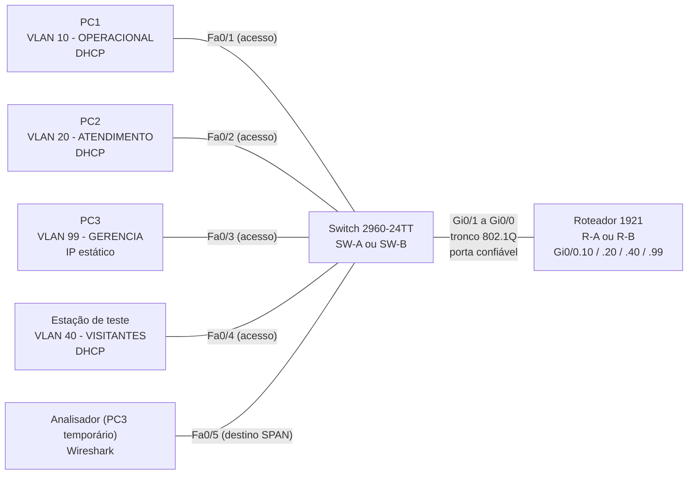

# Roteiro do Experimento 10 - A Filial Cresce: Expansão, DHCP Snooping, DAI e Diagnóstico de Falhas Provocadas

- **Instituição:** Universidade de Brasília (UnB)
- **Departamento:** Departamento de Engenharia Elétrica (ENE)
- **Curso:** Engenharia de Redes de Comunicação
- **Disciplina:** ENE0011 - Laboratório de Redes
- **Professor responsável:** Prof. Dr. Laerte Peotta de Melo
- **Tema:** Expansão de uma rede de filial, proteção contra *DHCP spoofing* e *ARP spoofing* e troubleshooting autônomo em equipamentos físicos

> **Pré-requisito:** Este laboratório dá continuidade direta à rede implantada no **Experimento 09**, cuja configuração deve estar salva no relatório do grupo. Utiliza os recursos de segurança do **Experimento 05** (DHCP Snooping e DAI) e a metodologia de diagnóstico do **Experimento 06**.

---

> **Recurso Didático:** os simuladores [Simul-Net: DHCP (DORA)](https://peotta.github.io/Simul-Net/#/sim/dhcp) e [Simul-Net: ARP](https://peotta.github.io/Simul-Net/#/sim/arp) permitem observar as mensagens DHCP e ARP (inclusive o envenenamento de cache e suas defesas) que o DHCP Snooping, o DAI e a captura com SPAN deste roteiro analisam.

## 1. Objetivo

Ampliar a rede da filial implantada no Experimento 09, protegê-la contra ataques de falsificação de identidade na camada 2 e exercitar o diagnóstico sistemático de falhas. A atividade é conduzida por **cenário** e **requisitos**, sem passo a passo e sem acompanhamento do professor.

Ao final da atividade, o grupo deverá ser capaz de:

- restaurar e revalidar uma configuração a partir da documentação produzida pela própria equipe;
- ampliar um plano de endereçamento VLSM utilizando o espaço previamente reservado;
- criar uma nova VLAN, com subinterface, pool DHCP e porta de acesso no switch;
- habilitar o DHCP Snooping e o *Dynamic ARP Inspection* (DAI) em um switch Cisco 2960 e verificar seu funcionamento;
- desativar portas não utilizadas como medida de endurecimento (*hardening*);
- compreender a importância do monitoramento de redes e configurar o espelhamento de porta (SPAN) para capturar e analisar tráfego;
- elaborar um plano de testes antes de executá-lo;
- provocar, diagnosticar e corrigir falhas em camadas distintas, aplicando a metodologia do Experimento 06.

---

## 2. Fundamentação Teórica

As Seções 2.1 a 2.3 organizam o que foi estudado, com aprofundamento nos Experimentos 05 (segurança) e 06 (diagnóstico). A Seção 2.4 introduz o monitoramento de redes e o espelhamento de porta.

### 2.1 Ficha Técnica: DHCP Snooping

| Campo | Descrição Técnica |
| :--- | :--- |
| **Nome** | *DHCP Snooping* (recurso de segurança de camada 2 dos switches Cisco) |
| **Camada de Referência** | Enlace, com inspeção de mensagens da camada de aplicação (DHCP) |
| **Problema tratado** | *DHCP spoofing*: um dispositivo malicioso responde às requisições dos clientes com configurações falsas (*gateway* e servidor de nomes, *Domain Name System* - DNS, controlados pelo atacante) |
| **Funcionamento** | Portas **confiáveis** (*trusted*) podem receber respostas do servidor (OFFER e ACK). Portas **não confiáveis** (*untrusted*) descartam essas respostas. O switch constrói uma **tabela de ligações** (*binding*) com endereço MAC (*Media Access Control*), IP, VLAN, porta e tempo de concessão |
| **Option 82** | O switch pode inserir a opção 82 (*Relay Agent Information*, [**RFC 3046**](https://datatracker.ietf.org/doc/html/rfc3046)) nas mensagens DHCP. Alguns servidores, como o do roteador Cisco, rejeitam essas mensagens quando não há agente de retransmissão |
| **Normas de referência** | [**RFC 2131**](https://datatracker.ietf.org/doc/html/rfc2131) (DHCP) e [**RFC 3046**](https://datatracker.ietf.org/doc/html/rfc3046) (opção 82) |

### 2.2 Ficha Técnica: *Dynamic ARP Inspection* (DAI)

| Campo | Descrição Técnica |
| :--- | :--- |
| **Nome** | *Dynamic ARP Inspection* (DAI), recurso Cisco |
| **Camada de Referência** | Enlace (camada 2) |
| **Problema tratado** | *ARP spoofing* (envenenamento de cache ARP), em que o atacante associa o próprio MAC ao IP de outro dispositivo |
| **Funcionamento** | Valida cada mensagem ARP recebida em portas não confiáveis comparando o par IP-MAC com a **tabela de ligações do DHCP Snooping**. Mensagens inválidas são descartadas e registradas |
| **Dependência** | Sem o DHCP Snooping não há tabela de ligações; hosts com IP estático não constam nela e têm o ARP descartado, a menos que a VLAN fique fora da inspeção |
| **Norma de referência** | [**RFC 826**](https://datatracker.ietf.org/doc/html/rfc826) (*Address Resolution Protocol*) |

### 2.3 Metodologia de Diagnóstico

O diagnóstico segue a ordem de camadas apresentada no Experimento 06: **física e enlace → endereçamento → VLANs e troncos → roteamento → serviços**. O recurso de segurança é tratado como *serviço* aplicado sobre o enlace, e suas falhas costumam se manifestar como falta de DHCP ou de ARP, aparentando defeito em camadas inferiores.

### 2.4 Monitoramento de Rede e Espelhamento de Porta (SPAN)

O **monitoramento de redes** é a observação contínua do estado dos equipamentos e do tráfego que circula por eles. Para a engenharia de redes, ele é a fonte de evidência de que a rede opera conforme projetada. Sem monitoramento, o administrador descobre as falhas pela reclamação do usuário e não consegue explicar a causa. Suas principais finalidades são:

- **Operação e diagnóstico:** localizar a causa de lentidão e de falhas com base em dados, e não em suposições (por exemplo, confirmar se uma mensagem DHCP chegou ao servidor);
- **Planejamento de capacidade:** medir utilização e crescimento para dimensionar enlaces antes que saturem;
- **Segurança:** detectar tráfego anômalo, tentativas de falsificação e vazamentos, alimentando sistemas de detecção de intrusão e a investigação forense de incidentes;
- **Conformidade e contratos:** comprovar níveis de serviço e manter registros de auditoria.

As técnicas de monitoramento se complementam, e cada uma responde a uma pergunta diferente:

| Técnica | O que fornece | Referência |
| :--- | :--- | :--- |
| Consulta de contadores e estado (*Simple Network Management Protocol* - SNMP, e comandos `show`) | Utilização, erros e estado de interfaces | [**RFC 3411**](https://datatracker.ietf.org/doc/html/rfc3411) |
| Registro de eventos (*syslog*) | Mensagens geradas pelo equipamento, como as do DAI | [**RFC 5424**](https://datatracker.ietf.org/doc/html/rfc5424) |
| Exportação de fluxos (NetFlow e *IP Flow Information Export* - IPFIX) | Quem conversa com quem, com volumes por fluxo | [**RFC 7011**](https://datatracker.ietf.org/doc/html/rfc7011) |
| **Captura de pacotes (espelhamento de porta)** | O conteúdo real dos quadros, campo a campo | Recurso do equipamento |

Em um switch, o tráfego de uma porta não é visível nas demais, porque o encaminhamento é feito pela tabela de endereços MAC. Para analisar o tráfego de uma estação, o switch precisa **copiar** os quadros para uma porta onde esteja o analisador. Esse recurso é o **espelhamento de porta**, denominado SPAN (*Switched Port Analyzer*) nos equipamentos Cisco.

| Campo | Descrição Técnica |
| :--- | :--- |
| **Nome** | *Switched Port Analyzer* (SPAN), ou espelhamento de porta (*port mirroring*) |
| **Camada de Referência** | Enlace (camada 2 do modelo OSI) |
| **Funcionamento** | Copia os quadros recebidos (*rx*), enviados (*tx*) ou ambos (*both*) por uma ou mais portas de **origem** para uma porta de **destino** |
| **Porta de destino** | Recebe apenas as cópias. Não encaminha tráfego normal e não participa da rede enquanto a sessão existir |
| **Variantes** | SPAN local (origem e destino no mesmo switch, usado neste experimento), *Remote SPAN* (RSPAN) e *Encapsulated Remote SPAN* (ERSPAN), que espelham o tráfego através da rede |
| **Limitações** | A porta de destino pode perder quadros se o volume copiado exceder sua capacidade (sobrecarga) |
| **Segurança** | A captura expõe credenciais e dados de protocolos sem criptografia, como Telnet e HTTP. Por isso, o recurso exige acesso privilegiado e deve ser removido ao fim do uso |

---

## 3. Cenário e Regras da Atividade

### 3.1 Cenário

Três meses após a implantação, a empresa decide oferecer rede aos **visitantes**, em uma VLAN própria. A diretoria também solicita uma auditoria de segurança: a filial não pode aceitar servidores DHCP não autorizados nem mensagens ARP falsificadas nas redes de usuários. A equipe deve ampliar a rede, ativar as proteções e comprovar o funcionamento.

Por fim, a equipe deve demonstrar domínio do diagnóstico: o grupo provoca falhas controladas em sua própria rede e as resolve com método.

### 3.2 Regras

1. O professor não conduz a configuração e atua somente em falhas de hardware.
2. Nenhum comando é digitado antes de o plano de endereçamento ampliado e o **plano de testes** (Seção 8) estarem escritos.
3. O grupo configura apenas os equipamentos da própria bancada.
4. Use as mesmas credenciais de laboratório do Experimento 09, que **não** devem ser reutilizadas em outros serviços.

---

## 4. Topologia e Preparação

### 4.1 Topologia Lógica

A topologia física é a mesma do Experimento 09. Acrescenta-se a porta `Fa0/4`, destinada à nova VLAN. Para testar a VLAN 40, a estação PC2 é movida temporariamente de `Fa0/2` para `Fa0/4`.



### 4.2 Restauração da Configuração do Experimento 09

Os equipamentos podem ter sido usados por outras turmas após o Experimento 09. A equipe deve:

1. Verificar o estado dos equipamentos (`show running-config`).
2. Se a configuração do Experimento 09 não estiver presente, **reaplicá-la a partir do `show running-config` entregue no relatório do Experimento 09**. Caso seja necessário o reset de fábrica, consulte a Seção 4.3 do Experimento 09.
3. Repetir os testes T1 a T12 do Experimento 09 e só prosseguir com todos aprovados.

> O relatório do Experimento 09 é a única fonte da configuração. Um grupo sem esse registro parte do reset de fábrica e refaz o Experimento 09.

---

## 5. Dados de Projeto

### 5.1 Blocos de Endereçamento por Grupo

| Grupo | Bloco IPv4 | Equipamentos |
| :---: | :--- | :--- |
| **A** | `10.10.0.0/24` | `SW-A` e `R-A` |
| **B** | `10.20.0.0/24` | `SW-B` e `R-B` |

### 5.2 Redes Lógicas

| VLAN | Nome | Hosts a atender | Porta | Endereçamento da estação |
| :---: | :--- | :---: | :---: | :--- |
| **10** | `OPERACIONAL` | 50 | `Fa0/1` | DHCP |
| **20** | `ATENDIMENTO` | 20 | `Fa0/2` | DHCP |
| **99** | `GERENCIA` | 10 | `Fa0/3` | IP estático |
| **40** | `VISITANTES` | 12 | `Fa0/4` | DHCP |

### 5.3 Convenções Obrigatórias

| Item | Convenção |
| :--- | :--- |
| Sub-rede da VLAN 40 | Primeira sub-rede adequada **dentro da metade superior do bloco** (`.128/25`), iniciando em `.128` |
| *Gateway* da VLAN 40 | **Último** endereço utilizável da sub-rede |
| Exclusões no DHCP | Os 5 primeiros endereços utilizáveis e o *gateway*, como nas demais pools |
| Hardening | DHCP Snooping e DAI **apenas nas VLANs 10, 20 e 40**. A VLAN 99 usa IP estático e fica fora da inspeção |
| Portas confiáveis | Somente `Gi0/1` (tronco para o roteador) |
| Portas não utilizadas | Todas as demais (`Fa0/5` a `Fa0/24` e `Gi0/2`) desativadas |
| Porta de monitoramento | `Fa0/5`, destino da sessão SPAN. É ativada somente durante a Seção 7.3 e desativada novamente ao final |

---

## 6. Requisitos

A coluna "Consultar" indica onde o assunto foi estudado.

| ID | Requisito | Consultar |
| :---: | :--- | :--- |
| **R1** | Restaurar e revalidar a configuração do Experimento 09 (Seção 4.2) | Exp. 09 |
| **R2** | Atualizar o plano de endereçamento com a VLAN 40, conforme a Seção 5.3 | Exp. 03 |
| **R3** | Criar a VLAN 40 `VISITANTES` e associar a porta `Fa0/4` | Exp. 04 e 05 |
| **R4** | Configurar a subinterface do roteador para a VLAN 40 e a pool DHCP correspondente | Exp. 04, 05 e 09 |
| **R5** | Habilitar o DHCP Snooping nas VLANs 10, 20 e 40, com `Gi0/1` como porta confiável | Exp. 05 |
| **R6** | Habilitar o DAI nas VLANs 10, 20 e 40, com `Gi0/1` como porta confiável | Exp. 05 |
| **R7** | Desativar as portas não utilizadas (Seção 5.3) | Exp. 04 e 05 |
| **R8** | Elaborar o plano de testes (Seção 8.1) antes da execução | Exp. 06 |
| **R9** | Provocar, diagnosticar e corrigir 3 falhas, conforme a Seção 8 | Exp. 06 |
| **R10** | Configurar uma sessão SPAN local e capturar o tráfego de uma estação, conforme a Seção 7.3 | Seção 7.3 |
| **R11** | Salvar as configurações finais com `copy running-config startup-config` | Exp. 02 |

---

## 7. Verificação e Testes (Critérios de Aceite)

### 7.1 Testes de Aceite

| ID | Teste | Onde executar | Resultado esperado |
| :---: | :--- | :--- | :--- |
| **T1** | Testes T1 a T12 do Experimento 09 | Equipamentos e estações | Todos aprovados antes das alterações |
| **T2** | `show vlan brief` e `show ip interface brief` | SW e R | VLAN 40 `VISITANTES` com `Fa0/4`; `Gi0/0.40` em `up/up` com o *gateway* do plano |
| **T3** | Conectar PC2 em `Fa0/4` e renovar a concessão | PC2 | Endereço dentro da sub-rede da VLAN 40, com máscara e *gateway* corretos |
| **T4** | `ping` da estação na VLAN 40 ao *gateway* e às demais VLANs | Estação | Resposta em todos os destinos |
| **T5** | `show ip dhcp snooping` | SW | Habilitado, nas VLANs 10, 20 e 40, com `Gi0/1` como porta confiável |
| **T6** | `show ip dhcp snooping binding` | SW | Uma entrada para cada estação que obteve concessão (MAC, IP, VLAN, porta e tempo) |
| **T7** | `show ip arp inspection vlan 10,20,40` e `show ip arp inspection interfaces` | SW | DAI habilitado nas três VLANs e `Gi0/1` confiável |
| **T8** | Configurar em PC1 um endereço **estático** da sub-rede da VLAN 10, diferente do concedido pelo DHCP, e tentar `ping` ao *gateway* | PC1 e SW | O `ping` falha; `show ip arp inspection statistics` mostra pacotes descartados (*Dropped*). Em seguida, devolver PC1 ao DHCP |
| **T9** | `show interfaces status` | SW | `Fa0/5` a `Fa0/24` e `Gi0/2` com o estado `disabled` (verificado antes da sessão SPAN) |
| **T10** | Sessão SPAN e captura de tráfego (Seção 7.3) | SW e PC3 | `show monitor session 1` com origem `Fa0/1` (*both*) e destino `Fa0/5`; captura com as quatro mensagens DHCP, ARP e ICMP identificadas |
| **T11** | *(Opcional)* Servidor DHCP falso em estação ligada a porta não confiável | SW | As ofertas do servidor falso não chegam aos clientes; `show ip dhcp snooping statistics` indica pacotes descartados |

No teste T8, o endereço estático precisa ser **diferente** do que o DHCP concedeu, porque a tabela de ligações mantém a concessão anterior até a expiração e um endereço igual ao concedido seria aceito pelo DAI.

### 7.2 Como Interpretar as Saídas

| Comando | O que observar |
| :--- | :--- |
| `show ip dhcp snooping` | Estado *enabled*, a lista de VLANs com snooping e, por interface, se é confiável (*trusted*) ou não, além do limite de taxa |
| `show ip dhcp snooping binding` | Colunas **MAC Address**, **IP Address**, **Lease (seconds)**, **Type** (`dhcp-snooping`), **VLAN** e **Interface**. Uma estação ausente na tabela não passará pelo DAI |
| `show ip arp inspection vlan` | Estado de DAI por VLAN (*Enabled*, *Active*) |
| `show ip arp inspection interfaces` | **Trust State** de cada porta e limite de taxa |
| `show ip arp inspection statistics` | Contadores **Forwarded** e **Dropped**. Valores crescentes em *Dropped* indicam ARP rejeitado pela inspeção |
| `show interfaces status` | Coluna **Status**: `connected`, `notconnect` ou `disabled` (desativada administrativamente) |
| `show monitor session 1` | Tipo da sessão (*Local Session*), portas de origem com a direção (*Both*, *RX* ou *TX*) e portas de destino. Uma sessão sem origem ou sem destino não copia tráfego |

### 7.3 Monitoramento com Espelhamento de Porta (SPAN)

Esta atividade demonstra que um switch pode ser configurado para monitorar o tráfego de uma estação. Os comandos são fornecidos, pois o recurso não foi estudado nos experimentos anteriores. A captura é feita **somente no ambiente de laboratório**, sobre o tráfego do próprio grupo.

**Preparação:**

1. Confirme que `Fa0/5` está desativada e que o teste T9 foi aprovado.
2. Verifique se o PC3 possui o **Wireshark** (com o Npcap, no Windows). O PC3 será o analisador e não precisa de endereço IP para a captura.
3. Desconecte o PC3 de `Fa0/3` e conecte-o a `Fa0/5`.

**Configuração da sessão no switch** (use `SW-A` ou `SW-B`; o texto após `!` é comentário e não deve ser digitado):

```cisco
SW-A# configure terminal
SW-A(config)# interface FastEthernet0/5
SW-A(config-if)# no shutdown                                              ! a porta de destino precisa estar ativa
SW-A(config-if)# exit
SW-A(config)# monitor session 1 source interface FastEthernet0/1 both     ! copia o tráfego recebido e enviado pelo PC1
SW-A(config)# monitor session 1 destination interface FastEthernet0/5     ! entrega a cópia ao analisador
SW-A(config)# end
SW-A# show monitor session 1                                              ! confere origem, destino e direção
```

Neste exercício, a origem é uma única porta (`Fa0/1`), o que simplifica a análise. A origem de uma sessão SPAN também pode ser **várias portas** (por exemplo, `source interface FastEthernet0/1 - 3 both`), **uma VLAN inteira** (`source vlan 10 both`) ou o **enlace tronco** (`source interface GigabitEthernet0/1 both`), capturando o tráfego de todas as VLANs entre o switch e o roteador. Em uma mesma sessão, a origem é formada por portas ou por VLANs, mas não pelos dois tipos. Quanto maior o volume espelhado, maior o risco de a porta de destino perder quadros.

**Captura e análise:**

1. No PC3, inicie a captura no Wireshark na placa de rede conectada ao switch.
2. No PC1, execute `ipconfig /release`, depois `ipconfig /renew` e, por fim, `ping -n 4 <gateway da VLAN 10>`.
3. Interrompa a captura e aplique os filtros de exibição `dhcp`, `arp` e `icmp`.
4. Registre, para cada uma das quatro mensagens DHCP (DISCOVER, OFFER, REQUEST e ACK): os MAC e IP de origem e destino, as portas UDP (67 e 68) e o valor da opção 53 (*DHCP Message Type*, definida na [**RFC 2132**](https://datatracker.ietf.org/doc/html/rfc2132)). Verifique também que as quatro mensagens compartilham o mesmo identificador de transação (*Transaction ID*).
5. Identifique o ARP *Request* (difusão) e o *Reply* (unicast) do PC1 ao *gateway*, e o par ICMP *Echo Request* e *Echo Reply*, anotando o TTL (*Time to Live*).

Durante a sessão, o PC3 não tem conectividade normal, pois a porta de destino só recebe as cópias.

**Encerramento:** a sessão e a porta de monitoramento devem ser removidas, pois um espelhamento esquecido permite a captura permanente do tráfego de uma estação.

```cisco
SW-A# configure terminal
SW-A(config)# no monitor session 1                                        ! remove o espelhamento
SW-A(config)# interface FastEthernet0/5
SW-A(config-if)# shutdown                                                 ! restaura a porta desativada
SW-A(config-if)# end
```

Reconecte o PC3 a `Fa0/3` e confirme que o teste T9 volta a ser aprovado.

---

## 8. Plano de Testes e Falhas Provocadas

### 8.1 Plano de Testes (R8)

Antes de configurar, o grupo escreve uma tabela com **pelo menos 8 testes**, cada um com: objetivo, comando ou ação, local de execução e resultado esperado. O plano deve cobrir as quatro dimensões da expansão: VLAN nova, DHCP da nova VLAN, DHCP Snooping e DAI. Os testes de aceite da Seção 7 são o ponto de partida, e o grupo pode acrescentar outros.

O plano é anexado ao relatório e deve estar **preenchido com os resultados reais** ao final da atividade.

### 8.2 Falhas Provocadas (R9)

Com a rede aprovada nos testes, o grupo provoca e resolve **três falhas**, seguindo estas regras:

1. As falhas devem pertencer a **camadas distintas** da metodologia (Seção 2.3), e **pelo menos uma** deve envolver o DHCP Snooping ou o DAI.
2. Cada falha deve ser **reversível com poucos comandos**. É vedado apagar a configuração inteira, mudar credenciais ou danificar o equipamento.
3. Antes de cada falha, o Papel 1 (Seção 10) registra a configuração que será alterada.
4. O Papel 1 introduz a falha **sem informar a equipe**. Os Papéis 2, 3 e 4 diagnosticam usando somente a metodologia e os comandos de verificação.
5. Cada falha é documentada na tabela abaixo.

| Campo | Conteúdo |
| :--- | :--- |
| **Falha nº** | 1, 2 ou 3 |
| **Camada** | Física, endereçamento, VLAN/tronco, roteamento ou serviços |
| **Alteração feita** | Comando ou ação executada |
| **Sintoma observado** | O que deixou de funcionar |
| **Diagnóstico** | Comandos usados, em ordem, e o raciocínio |
| **Correção** | Comandos aplicados |
| **Tempo** | Duração do diagnóstico |
| **Verificação** | Teste que comprova a normalização |

### 8.3 Sugestões de Falhas por Camada

| Camada | Exemplos de falha |
| :--- | :--- |
| Física e enlace | Porta de acesso desativada; cabo conectado a uma porta errada |
| Endereçamento | Máscara ou *gateway* incorretos na pool ou na estação |
| VLAN e tronco | Porta de acesso na VLAN errada; VLAN removida das permitidas no tronco; `encapsulation dot1Q` com ID divergente |
| Roteamento | Subinterface desativada ou com máscara incorreta |
| Serviços | `Gi0/1` sem confiança no DHCP Snooping ou no DAI; DAI habilitado na VLAN 99; pool DHCP com exclusão incorreta |

---

## 9. Diagnóstico de Falhas

Falhas típicas nos novos recursos. Valem as demais da Seção 8 do Experimento 09.

| Sintoma | Causa provável | Como verificar e corrigir |
| :--- | :--- | :--- |
| Estações deixam de receber IP após habilitar o DHCP Snooping | `Gi0/1` não confiável, ou opção 82 inserida pelo switch e rejeitada pelo servidor DHCP do roteador | `show ip dhcp snooping`. Consulte o Experimento 05 quanto à opção 82 |
| Estações com IP, mas sem `ping` ao *gateway*, após habilitar o DAI | `Gi0/1` sem confiança no DAI, ou estação com IP estático em VLAN inspecionada | `show ip arp inspection interfaces` e `show ip arp inspection statistics` |
| PC3 (VLAN 99) perde conectividade após o DAI | A VLAN 99 foi incluída na inspeção, mas PC3 usa IP estático e não está na tabela de ligações | Remover a VLAN 99 da lista do DAI (Seção 5.3) |
| Tabela de ligações vazia | Snooping não habilitado na VLAN, ou a estação ainda não renovou a concessão | `show ip dhcp snooping` e `ipconfig /release` seguido de `ipconfig /renew` |
| Estação mantém o IP antigo após mudar de porta | A concessão anterior ainda está ativa | Renovar a concessão na estação |
| Estação na VLAN 40 sem IP | Pool ausente, subinterface com `encapsulation dot1Q` divergente, VLAN 40 fora do tronco | `show ip dhcp pool`, `show ip interface brief` e `show interfaces trunk` |
| O analisador não recebe tráfego | Porta de destino desativada, sessão sem origem, ou captura iniciada na placa de rede errada | `show monitor session 1`, `show interfaces status` (`Fa0/5` deve estar `connected`) e seleção da placa no Wireshark |
| O Wireshark não lista quadros do PC1 | Sessão SPAN ausente ou a origem não é a porta do PC1 | Conferir a origem e a direção em `show monitor session 1` |
| Comando `monitor session` não reconhecido | Imagem do IOS sem suporte ao recurso | Registrar a limitação no relatório |
| Comandos de DAI ou de Snooping não reconhecidos | Imagem do IOS sem suporte ao recurso | Registrar a limitação no relatório |

---

## 10. Organização da Equipe

Os papéis **giram** em relação ao Experimento 09: cada estudante assume o papel seguinte (o Papel 5 do Experimento 09 passa a ser o Papel 1 neste).

| Papel | Responsabilidade |
| :---: | :--- |
| **1. Provocador de falhas e preparação** | Restauração da configuração, cabeamento e introdução das falhas da Seção 8.2 |
| **2. Switch** | Configuração do switch (R3, R5, R6, R7 e R10) |
| **3. Roteador** | Configuração do roteador (R4) |
| **4. Estações e testes** | Execução dos testes e diagnóstico das falhas |
| **5. Documentação** | Plano de endereçamento ampliado, plano de testes e registro das falhas |

---

## 11. Questões para Análise

1. Explique como o DHCP Snooping distingue portas confiáveis de não confiáveis. Por que `Gi0/1` é confiável e o que ocorreria se as portas das estações também fossem?
2. Por que o DAI depende do DHCP Snooping? Explique por que a VLAN 99 foi mantida fora da inspeção e qual risco de segurança decorre dessa decisão.
3. Interprete cada campo de uma entrada de `show ip dhcp snooping binding` obtida na atividade.
4. Justifique a escolha da sub-rede da VLAN 40 e informe quantas sub-redes de mesmo tamanho ainda cabem na metade superior do bloco.
5. Para cada falha provocada, informe a camada, os comandos usados e como a ordem da metodologia reduziu o tempo de diagnóstico.
6. Cite dois ataques de camada 2 que o DHCP Snooping e o DAI **não** impedem e justifique.
7. Qual a importância do monitoramento para a engenharia de redes? Por que a porta de destino do SPAN não encaminha tráfego normal e que cuidados de segurança o uso do espelhamento exige?

---

## 12. Critérios de Avaliação

A avaliação do relatório do grupo será realizada com base na seguinte rubrica, totalizando exatamente 10,0 pontos:

| Critério de Avaliação | Pontuação Máxima |
| :--- | :---: |
| **Expansão:** VLAN 40, subinterface, pool DHCP, porta de acesso e plano de endereçamento atualizado | 1,5 |
| **DHCP Snooping:** Habilitação nas VLANs corretas, porta confiável e tabela de ligações | 1,5 |
| **DAI:** Habilitação nas VLANs corretas, porta confiável e teste de bloqueio (T8) | 1,5 |
| **Hardening das Portas Não Utilizadas e Salvamento das Configurações** | 0,5 |
| **Testes de Aceite:** Evidências legíveis dos testes T1 a T9 e análise das saídas | 1,5 |
| **Monitoramento com SPAN:** Sessão configurada, captura e análise das mensagens DHCP, ARP e ICMP (T10) | 0,5 |
| **Plano de Testes e Falhas Provocadas:** Plano preenchido e três falhas em camadas distintas, documentadas conforme a Seção 8.2 | 2,0 |
| **Respostas às Questões Técnicas:** Análise fundamentada das questões da Seção 11 | 1,0 |
| **Total** | **10,0** |

---

## 13. Entregáveis

Cada grupo submete **um único relatório técnico**, contendo:

1. Identificação do grupo (A ou B), dos integrantes e dos papéis assumidos.
2. Plano de endereçamento atualizado com a VLAN 40, com os cálculos de VLSM.
3. Plano de testes preenchido com os resultados reais (Seção 8.1).
4. Saída de `show running-config` do switch e do roteador, após `copy running-config startup-config`.
5. Evidências dos testes T1 a T10 (e T11, se realizado), produzidas pelos próprios estudantes, com breve análise das saídas. Para o T10, incluir a saída de `show monitor session 1` e a captura do Wireshark com as quatro mensagens DHCP identificadas.
6. Tabelas das três falhas provocadas, conforme a Seção 8.2.
7. Respostas fundamentadas às 7 questões da Seção 11.

---

## 14. Conclusão

Neste experimento, a equipe ampliou a rede da filial com uma nova VLAN, reutilizando o espaço reservado no plano de endereçamento, e aplicou o DHCP Snooping e o DAI para impedir a falsificação de servidores DHCP e de mensagens ARP. O diagnóstico de falhas provocadas, conduzido em camadas e com registro formal, consolida a postura investigativa necessária ao trabalho em redes. O espelhamento de porta mostrou como observar o tráfego real da rede, base do monitoramento e da análise de segurança. A rede protegida e documentada é a base do Experimento 11, no qual as duas filiais serão interligadas.

---

[← Anterior: Experimento 09](09_roteiro.md) | [Índice Geral (README)](../README.md) | [Próximo: Experimento 11 →](11_roteiro.md)
