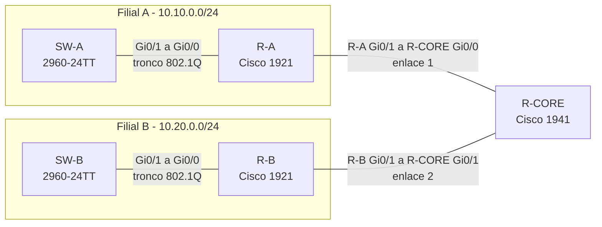

# Roteiro do Experimento 11 - Interligação de Filiais com Roteamento Estático

- **Instituição:** Universidade de Brasília (UnB)
- **Departamento:** Departamento de Engenharia Elétrica (ENE)
- **Curso:** Engenharia de Redes de Comunicação
- **Disciplina:** ENE0011 - Laboratório de Redes
- **Professor responsável:** Prof. Dr. Laerte Peotta de Melo
- **Tema:** Integração de duas redes de filial por um roteador central Cisco 1941, com rotas estáticas, testes fim a fim e análise de falhas de roteamento

> **Pré-requisito:** Este laboratório integra as redes implantadas nos **Experimentos [09](09_roteiro.md) e [10](10_roteiro.md)** pelas duas equipes. Utiliza o roteamento estático do [**Experimento 04**](04_roteiro.md) e a metodologia de diagnóstico do [**Experimento 06**](06_roteiro.md).

---

> **Recurso Didático:** o simulador [Simul-Net: ICMP (ping e traceroute)](https://peotta.github.io/Simul-Net/#/sim/icmp) reproduz Echo, Time Exceeded e Destination Unreachable, úteis para interpretar o `tracert` dos testes T6 e T9.

## 1. Objetivo

Interligar as filiais montadas separadamente pelos Grupos A e B por meio de um roteador central, de forma autônoma e cooperativa. A atividade é conduzida por **cenário** e **requisitos**: as duas equipes decidem em conjunto como cumpri-los, consultando os experimentos anteriores.

Ao final da atividade, os grupos deverão ser capazes de:

- projetar o endereçamento dos enlaces ponto a ponto entre roteadores com máscara `/30`;
- preparar e proteger um roteador compartilhado por duas equipes (acesso por SSH (*Secure Shell*) com usuários distintos);
- configurar rotas estáticas que alcancem todas as VLANs (*Virtual Local Area Networks*) de uma filial por uma única entrada (agregação do bloco `/24`);
- validar a conectividade fim a fim com `ping`, `tracert` e SSH entre filiais;
- interpretar a tabela de roteamento (`show ip route`) e o comportamento das rotas estáticas quando o enlace falha;
- diagnosticar a falta de rota de retorno, uma das falhas mais comuns em roteamento estático;
- trabalhar de forma cooperativa entre equipes, com um acordo de endereçamento documentado.

---

## 2. Fundamentação Teórica

Esta seção apenas organiza o que foi estudado. O aprofundamento está nos Experimentos [03](03_roteiro.md), [04](04_roteiro.md) e [06](06_roteiro.md).

### 2.1 Ficha Técnica: Roteamento Estático

| Campo | Descrição Técnica |
| :--- | :--- |
| **Nome** | Roteamento estático (rotas configuradas manualmente pelo administrador) |
| **Camada de Referência** | Rede (camada 3 do modelo OSI) |
| **Mecanismo** | Cada entrada associa uma rede de destino (endereço e máscara) a um **próximo salto** (endereço IP de um roteador vizinho) ou a uma interface de saída |
| **Distância administrativa** | 1 nos roteadores Cisco (rotas estáticas têm preferência sobre as aprendidas por protocolos de roteamento) |
| **Vantagens** | Simples, previsível e sem consumo de processamento ou de banda por protocolos de roteamento |
| **Limitações** | Não se adapta a mudanças: falhas e novas redes exigem alteração manual. A rota para um próximo salto desaparece da tabela se a interface de saída ficar inoperante |
| **Endereçamento** | Faixas privadas definidas na [**RFC 1918**](https://datatracker.ietf.org/doc/html/rfc1918) (`10.0.0.0/8` neste experimento) |

### 2.2 Agregação de Rotas

A **agregação** (ou sumarização) substitui várias rotas de redes contíguas por uma única entrada de máscara menor, prática associada ao CIDR (*Classless Inter-Domain Routing*, [**RFC 4632**](https://datatracker.ietf.org/doc/html/rfc4632)). Neste experimento, cada filial usa todas as suas sub-redes (VLANs 10, 20, 40 e 99) dentro de um mesmo bloco `/24`. Os roteadores remotos precisam, portanto, de **uma só rota** por filial, e não de uma rota por VLAN. Esse resultado decorre do planejamento do endereçamento feito nos Experimentos [09](09_roteiro.md) e [10](10_roteiro.md).

### 2.3 Diagnóstico de Caminho: `ping` e `tracert`

| Ferramenta | Funcionamento |
| :--- | :--- |
| `ping` | Envia mensagens *Echo Request* do ICMP (*Internet Control Message Protocol*) e aguarda *Echo Reply* ([**RFC 792**](https://datatracker.ietf.org/doc/html/rfc792)) |
| `tracert` (Windows) | Envia *Echo Request* com o campo TTL (*Time to Live*, definido na [**RFC 791**](https://datatracker.ietf.org/doc/html/rfc791)) crescente: 1, 2, 3... Cada roteador que descarta o pacote por TTL esgotado responde com ICMP *Time Exceeded*, e o endereço de origem dessa resposta revela o salto |
| `traceroute` (Linux) | Mesma lógica, por padrão com datagramas UDP em portas altas |

A resposta *Time Exceeded* de cada roteador **retorna à origem pela tabela de roteamento do próprio roteador**. Se ele não tem rota para a rede de origem, o salto aparece como `*` no resultado. Essa característica é usada no teste T9.

### 2.4 Normas de Referência

Complementam as normas já citadas nesta seção ([**RFC 791**](https://datatracker.ietf.org/doc/html/rfc791), [**RFC 792**](https://datatracker.ietf.org/doc/html/rfc792), [**RFC 1918**](https://datatracker.ietf.org/doc/html/rfc1918) e [**RFC 4632**](https://datatracker.ietf.org/doc/html/rfc4632)) as RFCs abaixo.

| Assunto | Norma | Aplicação neste experimento |
| :--- | :--- | :--- |
| Encaminhamento e rotas estáticas | [**RFC 1812**](https://datatracker.ietf.org/doc/html/rfc1812) | Requisitos de roteadores IPv4, inclusive rota mais específica e rota padrão |
| Resolução de endereços | [**RFC 826**](https://datatracker.ietf.org/doc/html/rfc826) | ARP (*Address Resolution Protocol*) nas interfaces dos enlaces de trânsito `/30` |
| Enlaces ponto a ponto | [**RFC 3021**](https://datatracker.ietf.org/doc/html/rfc3021) | Uso de `/31` em enlaces ponto a ponto, alternativa ao `/30` adotado neste experimento |
| Acesso remoto seguro | [**RFC 4251**](https://datatracker.ietf.org/doc/html/rfc4251), [**RFC 4253**](https://datatracker.ietf.org/doc/html/rfc4253) | SSH versão 2 no `R-CORE`, com Telnet desabilitado |

---

## 3. Cenário e Regras da Atividade

### 3.1 Cenário

A empresa decide interligar as duas filiais por meio de um roteador central (`R-CORE`, o Cisco 1941), que também será a futura saída para a matriz. Nesta etapa, a interligação deve usar **somente rotas estáticas**. Cada filial mantém o endereçamento, o DHCP (*Dynamic Host Configuration Protocol*) e o hardening dos experimentos anteriores, e a nova interligação não pode removê-los.

Os dois grupos compartilham o `R-CORE`. Por isso, a configuração, o acesso administrativo e os testes exigem **acordo prévio entre as equipes**.

### 3.2 Regras

1. O professor não conduz a configuração e atua somente em falhas de hardware.
2. Nenhum comando é digitado no `R-CORE` antes de os dois grupos terem preenchido e comparado a Tabela de Acordo (Seção 5.4).
3. Cada grupo configura somente o roteador da própria filial. A configuração do `R-CORE` é feita em conjunto, com um representante de cada grupo na console.
4. Os testes de falha (T8 e T9) são executados **um grupo por vez** e comunicados ao outro grupo.
5. Use senhas de laboratório, que **não** sejam reutilizadas em outros serviços.

---

## 4. Topologia e Preparação

### 4.1 Topologia Lógica

### 4.2 Cabeamento

| Origem | Destino | Cabo | Função |
| :--- | :--- | :---: | :--- |
| `R-A Gi0/1` | `R-CORE Gi0/0` | Direto | Enlace 1 (Filial A e núcleo) |
| `R-B Gi0/1` | `R-CORE Gi0/1` | Direto | Enlace 2 (Filial B e núcleo) |
| Console de `R-CORE` | Estação de configuração | Console (azul ou USB) | Configuração conjunta |

As interfaces Gigabit dos roteadores possuem auto-MDIX, e o cabo direto é suficiente. Cabos de comprimento adequado devem ligar as duas bancadas ao `R-CORE`, que fica em posição acessível aos dois grupos. As demais ligações (estações e switch) permanecem como no [Experimento 10](10_roteiro.md).

### 4.3 Preparação

1. **Revalidar as filiais.** Cada grupo verifica o estado de seus equipamentos e repete os testes T1 a T9 do [Experimento 10](10_roteiro.md). Se a configuração não estiver presente, restaure-a a partir do relatório do [Experimento 10](10_roteiro.md). O cabo para o `R-CORE` só é conectado após a aprovação.
2. **Reset de fábrica do `R-CORE`.** Realizado pelos representantes dos dois grupos, seguindo as Seções 4.3.1, 4.3.3 e 4.3.4 do [Experimento 09](09_roteiro.md) (acesso à console, reset do roteador e verificação do estado de fábrica).
3. **Estações de teste.** Além das orientações do [Experimento 09](09_roteiro.md) (Wi-Fi desativado e rede única), o *firewall* do Windows deve permitir o ICMPv4 de entrada **a partir de qualquer endereço remoto**. A regra padrão de compartilhamento de arquivos e impressoras costuma restringir o escopo à sub-rede local, o que bloqueia pings vindos da outra filial mesmo com a regra habilitada.

---

## 5. Dados de Projeto

### 5.1 Blocos das Filiais

| Filial | Bloco IPv4 | Equipamentos |
| :---: | :--- | :--- |
| **A** | `10.10.0.0/24` | `SW-A` e `R-A` |
| **B** | `10.20.0.0/24` | `SW-B` e `R-B` |

Os planos de endereçamento internos são os do [Experimento 10](10_roteiro.md) (VLANs 10, 20, 40 e 99) e **não são alterados**.

### 5.2 Bloco dos Enlaces de Interligação

| Item | Definição |
| :--- | :--- |
| Bloco | `10.255.0.0/24`, reservado para enlaces entre roteadores |
| Alocação | Duas sub-redes `/30` contíguas a partir do início do bloco: a primeira para o enlace 1 (`R-A` e `R-CORE`) e a segunda para o enlace 2 (`R-B` e `R-CORE`) |
| Atribuição de endereços | `R-A` e `R-B`: **primeiro** endereço utilizável do respectivo enlace. `R-CORE`: **segundo** endereço utilizável |

### 5.3 Convenções Obrigatórias

| Item | Convenção |
| :--- | :--- |
| Identificação do roteador central | *Hostname* `R-CORE` e domínio `lab.local` |
| Acesso administrativo ao `R-CORE` | SSH versão 2, `enable secret` e **um usuário local por grupo** (`grupoA` e `grupoB`), com Telnet desabilitado |
| Rotas estáticas | **Uma rota por filial remota**, para o bloco `/24` inteiro, usando o **endereço do próximo salto**. Não é permitida rota padrão |
| Filiais | Manter DHCP Snooping, *Dynamic ARP Inspection* (DAI) e portas desativadas do [Experimento 10](10_roteiro.md) |

### 5.4 Tabela de Acordo

Os dois grupos preenchem **separadamente** a tabela abaixo e depois a comparam. Divergências são resolvidas entre as equipes antes de qualquer configuração no `R-CORE`.

| Enlace | Interface | Equipamento | Endereço IP | Máscara |
| :---: | :--- | :--- | :--- | :--- |
| 1 | `Gi0/1` | R-A | | |
| 1 | `Gi0/0` | R-CORE | | |
| 2 | `Gi0/1` | R-B | | |
| 2 | `Gi0/1` | R-CORE | | |

---

## 6. Requisitos

| ID | Requisito | Consultar |
| :---: | :--- | :--- |
| **R1** | Revalidar a filial (testes T1 a T9 do [Experimento 10](10_roteiro.md)) antes da conexão | Exp. [10](10_roteiro.md) |
| **R2** | Preencher e comparar a Tabela de Acordo (Seção 5.4), calculando as duas sub-redes `/30` | Exp. [03](03_roteiro.md) |
| **R3** | Reset de fábrica do `R-CORE` e configuração de identificação e acesso seguro (Seção 5.3) | Exp. [02](02_roteiro.md) e [09](09_roteiro.md) |
| **R4** | Configurar as interfaces de interligação dos três roteadores, conforme a Tabela de Acordo | Exp. [04](04_roteiro.md) |
| **R5** | Configurar a rota estática de cada filial para o bloco da outra filial, usando o `R-CORE` como próximo salto | Exp. [04](04_roteiro.md) |
| **R6** | Configurar no `R-CORE` as rotas estáticas para os blocos das duas filiais | Exp. [04](04_roteiro.md) |
| **R7** | Executar os testes fim a fim T4 a T7 | Exp. [06](06_roteiro.md) |
| **R8** | Executar os testes de falha T8 e T9 e registrar o comportamento observado | Exp. [06](06_roteiro.md) |
| **R9** | Salvar as configurações finais com `copy running-config startup-config` | Exp. [02](02_roteiro.md) |

---

## 7. Verificação e Testes (Critérios de Aceite)

### 7.1 Testes de Aceite

| ID | Teste | Onde executar | Resultado esperado |
| :---: | :--- | :--- | :--- |
| **T1** | Testes T1 a T9 do [Experimento 10](10_roteiro.md) | Filial de cada grupo | Todos aprovados antes da interligação (R1) |
| **T2** | `show ip interface brief` | R-A, R-B e R-CORE | Interfaces de interligação em `up/up`, com os endereços da Tabela de Acordo |
| **T3** | `ping` aos endereços do vizinho de enlace | R-A, R-B e R-CORE | Resposta nos dois sentidos de cada enlace |
| **T4** | `show ip route` | R-A, R-B e R-CORE | Uma rota estática (código `S`) para o bloco da filial remota em R-A e R-B; duas rotas `S` (blocos A e B) no R-CORE |
| **T5** | `ping` do PC1 de uma filial ao PC1 da outra filial e aos quatro *gateways* (VLANs 10, 20, 40 e 99) da filial remota | PC1 de A e PC1 de B | Resposta em todos os destinos, nos dois sentidos |
| **T6** | `tracert` do PC1 de A ao PC1 de B | PC1 de A | Quatro saltos: *gateway* da VLAN 10 (R-A), `R-CORE` (`Gi0/0`), `R-B` (`Gi0/1`) e o destino |
| **T7** | SSH de PC3 de uma filial ao roteador e ao switch da filial remota e ao `R-CORE` | PC3 de A e PC3 de B | Autenticação bem-sucedida. No `R-CORE`, cada grupo usa o próprio usuário |
| **T8** | Desconectar o cabo do enlace 1, observar `show ip route` e `ping`, e reconectar | R-A, R-CORE e PC1 de A | A rota estática para a filial remota desaparece de R-A, o `ping` falha, e tudo normaliza ao reconectar |
| **T9** | Remover temporariamente em R-B a rota estática para A, executar `tracert` de A para B e restaurar a rota | R-B e PC1 de A | O `tracert` mostra os dois primeiros saltos e `*` a partir do terceiro; o `ping` falha. A conectividade volta ao restaurar a rota |
| **T10** | `show ip dhcp snooping`, `show ip arp inspection vlan` e `show running-config` (no R-CORE) | SW de cada filial e R-CORE | Hardening dos switches inalterado; no `R-CORE`, nenhuma senha em texto claro e Telnet desabilitado |

Os testes T8 e T9 são executados por um grupo por vez. No T9, o grupo B remove a rota enquanto o grupo A observa, e depois os papéis se invertem para o teste equivalente em R-A.

### 7.2 Como Interpretar as Saídas

| Comando | O que observar |
| :--- | :--- |
| `show ip route` | Códigos: `C` (rede diretamente conectada), `L` (endereço local da interface) e `S` (rota estática). Uma entrada `S` apresenta a rede de destino, o par **[distância administrativa/métrica]**, que para rotas estáticas é `[1/0]`, e o próximo salto (`via`) com a interface de saída. A linha `Gateway of last resort is not set` indica a ausência de rota padrão, conforme exigido |
| `show ip interface brief` | Colunas **IP-Address**, **Status** e **Protocol**. `up/up` indica enlace e protocolo operacionais; `down/down` indica ausência de enlace físico |
| `tracert` | Cada linha é um salto. O endereço mostrado é o da interface **de entrada** do roteador naquele salto. Linhas com `*` indicam que a resposta *Time Exceeded* não chegou à origem |
| `ping` em roteador Cisco | `!` indica resposta recebida, `.` indica tempo esgotado e `U` indica destino inalcançável (sem rota) |

---

## 8. Diagnóstico de Falhas

Utilize a metodologia em camadas: **física e enlace → endereçamento → VLANs e troncos → roteamento → serviços**.

| Sintoma | Causa provável | Como verificar e corrigir |
| :--- | :--- | :--- |
| Interface de interligação em `down/down` | Cabo desconectado, porta desligada ou porta errada | Conferir a Seção 4.2; `show ip interface brief`; `no shutdown` |
| `ping` ao vizinho de enlace falha | Endereço ou máscara divergentes da Tabela de Acordo; as duas pontas em sub-redes diferentes | Comparar `show ip interface brief` dos dois lados e refazer a Tabela de Acordo |
| A rota `S` não aparece em `show ip route` | Próximo salto fora da sub-rede de um enlace ativo, ou interface de saída `down` | Conferir o endereço do próximo salto e o estado da interface |
| `ping` de ida funciona em `R-A`, mas as estações da filial A não alcançam B | Falta de rota de retorno em `R-B` ou em `R-CORE` | `show ip route` nos três roteadores; `tracert` para localizar o salto onde surge `*` |
| `tracert` mostra `*` a partir de um salto | O roteador desse salto não tem rota para a origem | Incluir a rota para o bloco de origem no roteador identificado |
| Estação não responde a `ping` da outra filial, mas responde dentro da própria filial | *Firewall* do host com escopo de ICMP restrito à sub-rede local | Ajustar o escopo remoto da regra ICMPv4 de entrada (Seção 4.3) |
| SSH funciona ao roteador remoto, mas não ao switch remoto | Falta de `ip default-gateway` no switch remoto | `show running-config \| include default-gateway` no switch |
| Rotas funcionam, mas as estações da filial perderam DHCP | Alteração indevida nas VLANs ou no tronco da filial durante a integração | Repetir T1 ([Experimento 10](10_roteiro.md)) e comparar com a configuração salva |

---

## 9. Organização da Equipe

Os papéis **giram** em relação ao [Experimento 10](10_roteiro.md): cada estudante assume o papel seguinte (o Papel 5 do [Experimento 10](10_roteiro.md) passa a ser o Papel 1 neste).

| Papel | Responsabilidade |
| :---: | :--- |
| **1. Cabeamento e acordo** | Cabeamento, reset do `R-CORE` e coordenação da Tabela de Acordo com o outro grupo |
| **2. Roteador da filial** | Interface de interligação e rota estática de `R-A` ou `R-B` (R4 e R5) |
| **3. Roteador central** | Configuração do `R-CORE` junto com o Papel 3 do outro grupo (R3, R4 e R6) |
| **4. Estações e testes** | Execução dos testes T4 a T10 |
| **5. Documentação** | Tabela de Acordo, registro das evidências e rascunho do relatório |

---

## 10. Questões para Análise

1. Quantas rotas estáticas cada roteador possui e por que uma única rota `/24` cobre as quatro VLANs de uma filial? Relacione a resposta com a alocação feita nos Experimentos [09](09_roteiro.md) e [10](10_roteiro.md).
2. Por que a falta de rota de retorno impede a comunicação mesmo quando a rota de ida está correta? Use o resultado do `tracert` do teste T9.
3. Interprete os campos de uma entrada `S` de `show ip route` obtida na atividade e explique o que ocorreu com essa entrada no teste T8. Qual limitação do roteamento estático isso evidencia?
4. Descreva os quatro saltos do `tracert` do teste T6, explicando como o TTL e a mensagem ICMP *Time Exceeded* permitem identificar cada roteador.
5. Por que o DHCP Snooping e o DAI configurados no [Experimento 10](10_roteiro.md) não interferem no tráfego roteado entre as filiais?
6. Que riscos de segurança surgem do compartilhamento do `R-CORE` entre dois grupos? Cite duas medidas de mitigação.

---

## 11. Critérios de Avaliação

A avaliação do relatório do grupo será realizada com base na seguinte rubrica, totalizando exatamente 10,0 pontos:

| Critério de Avaliação | Pontuação Máxima |
| :--- | :---: |
| **Endereçamento dos Enlaces e Tabela de Acordo:** Cálculo das sub-redes `/30` e tabela preenchida de forma consistente entre os grupos | 1,0 |
| **`R-CORE`:** Reset, identificação, acesso seguro e interfaces corretos | 1,5 |
| **Rotas Estáticas:** Rotas por filial (agregadas, com próximo salto) em R-A ou R-B e no R-CORE | 2,0 |
| **Conectividade Fim a Fim:** Evidências de T5, T6 e T7 | 2,0 |
| **Testes de Falha:** T8 e T9 executados, com análise do comportamento observado | 1,5 |
| **Documentação:** Configurações finais salvas, hardening preservado (T10) e relatório organizado | 1,0 |
| **Respostas às Questões Técnicas:** Análise fundamentada das questões da Seção 10 | 1,0 |
| **Total** | **10,0** |

---

## 12. Entregáveis

Cada grupo submete **um único relatório técnico**, contendo:

1. Identificação do grupo (A ou B), dos integrantes e dos papéis assumidos.
2. Tabela de Acordo preenchida (Seção 5.4), com os cálculos das sub-redes `/30`.
3. Evidências do reset de fábrica e da configuração do `R-CORE` (saídas da Seção 4.3.4 do [Experimento 09](09_roteiro.md) e `show running-config` do `R-CORE`).
4. Saída de `show running-config` do roteador e do switch da própria filial, após `copy running-config startup-config`.
5. Saída de `show ip route` e `show ip interface brief` dos três roteadores.
6. Evidências dos testes T4 a T10, produzidas pelos próprios estudantes, com breve análise das saídas.
7. Respostas fundamentadas às 6 questões da Seção 10.

---

## 13. Conclusão

Neste experimento, as duas filiais construídas separadamente foram integradas por um roteador central, com rotas estáticas agregadas e acordo de endereçamento entre as equipes. Os testes fim a fim e de falha evidenciaram, na prática, tanto a simplicidade do roteamento estático quanto sua principal limitação: a ausência de adaptação automática a mudanças. A análise de caminho com `tracert` e a falta de rota de retorno consolidam a metodologia de diagnóstico em camadas, encerrando a sequência de experimentos com equipamentos físicos.

---

[← Anterior: Experimento 10](10_roteiro.md) | [Índice Geral (README)](../README.md)
